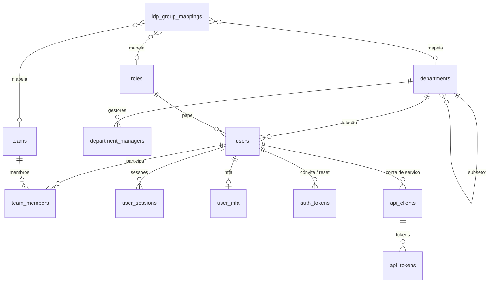
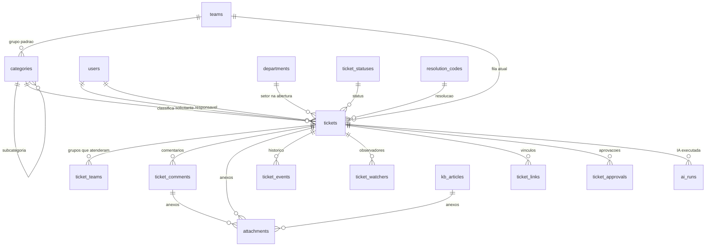

# 4. Modelo de dados

Esboço completo e comentado: [`esboco-schema.sql`](esboco-schema.sql). Ele é o ponto de partida da primeira migração Alembic e ainda vai mudar.

## Diagrama de entidades (simplificado)

Organização, identidade e acesso ([08](08-organizacao-e-permissoes.md), [09](09-login-e-autenticacao.md)):

Chamados ([10](10-chamados.md), [11](11-anexos-e-arquivos.md)):

## Decisões de modelagem

| Tema | Decisão | Motivo |
|------|---------|--------|
| Chave primária | `bigint GENERATED ALWAYS AS IDENTITY` internamente + `public_id uuid` exposto na API | Joins e índices compactos; não expõe IDs sequenciais adivinháveis. `gen_random_uuid()` é nativo desde o PG 13 (o `uuidv7()` nativo só existe a partir do PG 18) |
| Número do chamado | Coluna `number` alimentada pela sequence `ticket_number_seq`, exibida como `#000123` | Legível para humanos |
| Status | Tabela `ticket_statuses` com um `kind` fixo (`approval`, `open`, `waiting`, `resolved`, `closed`, `canceled`); status novos criados pelo admin escolhem um `kind` | Nomes de status configuráveis, enquanto as regras dependem do `kind` |
| Prioridade | `impact` e `urgency` (1–3) + `priority` (1–4) calculada pela matriz; `priority_overridden` quando o agente força outro valor | Ver [10.3](10-chamados.md#103-prioridade-impacto--urgência) |
| Setor do chamado | `tickets.department_id` guarda o setor do solicitante **na abertura** | Relatórios corretos mesmo se a pessoa mudar de setor |
| Visibilidade | `ticket_teams` (grupos que já atenderam) e `ticket_watchers.kind = 'mentioned'` alimentam o filtro de visibilidade | Regras 6 e 10 de [8.4](08-organizacao-e-permissoes.md#84-regras-de-visibilidade-de-chamados) sem varrer o histórico |
| Papéis | Tabela `roles` com `permissions text[]`; papéis do sistema vindos de *seed* | Papéis personalizados na Fase 2 sem mudar o schema |
| Auditoria | `ticket_events` (o que acontece no chamado) separado de `audit_log` (login, administração, permissões) | Consultas e retenção diferentes |
| Anexos | Tabela única `attachments` com dono opcional; sem dono = upload temporário | Upload em duas etapas ([11.4](11-anexos-e-arquivos.md#114-fluxo-de-envio-em-duas-etapas)) |
| Sessões | `user_sessions` no banco, só com hashes | Revogação imediata, lista de sessões ativas |
| Datas | Sempre `timestamptz` | Evita problemas de fuso horário |
| Histórico | `ticket_events` só aceita inserção (append-only), com `payload jsonb` (antes/depois) | Auditoria completa, base para a linha do tempo |
| Campos personalizados | `custom_fields jsonb` no chamado + definição JSON Schema na categoria | Flexível sem migração a cada novo campo |
| Busca textual | Coluna gerada `search_vector` com configuração `pt_br` (português + unaccent) e índice GIN | Nativo e mantido automaticamente |
| Busca semântica | Tabela `embeddings` com `vector` (pgvector) e índice HNSW | Uma tabela para chamados, comentários e artigos |
| Exclusão | Exclusão lógica (`deleted_at`) para chamados; anonimização para atender à LGPD | Preserva auditoria e permite o direito ao esquecimento |
| Multi-empresa | **Uma instalação por empresa** (*single-tenant*): sem `tenant_id` | Isolamento total dos dados e schema mais simples. Ver [ADR 0005](adr/0005-instalacao-por-empresa.md) |
| Configuração de IA | `ai_endpoints` guarda URL, referência ao segredo e nome do modelo como texto livre | API genérica, sem tabela de provedores. Ver [ADR 0004](adr/0004-ia-api-generica-e-assistiva.md) |
| Dimensão dos embeddings | Definida na instalação (`AI_EMBEDDING_DIM`) e aplicada pela migração | Depende do modelo configurado; trocar de modelo exige reindexar |

## Compatibilidade PostgreSQL 16 × 17

O schema usa apenas recursos disponíveis nas **duas** versões. Recursos exclusivos do 17, como `JSON_TABLE`, as funções SQL/JSON (`JSON_QUERY`, `JSON_VALUE`, `JSON_EXISTS`) e o `MERGE ... RETURNING`, **não** devem ser usados no código da aplicação enquanto o 16 for suportado. O CI roda os testes nas duas versões.

Extensões necessárias:

- `pgvector` (≥ 0.7): busca semântica
- `unaccent`: busca sem acentos (contrib, já vem com o PostgreSQL)
- `pg_trgm`: busca por similaridade em títulos e autocompletar (contrib)
- `citext`: e-mails sem distinção de maiúsculas e minúsculas (contrib)

## Volumes estimados (empresa, até 50 usuários)

| Tabela | Volume em 3 anos |
|--------|------------------|
| `tickets` | ~15 mil |
| `ticket_comments` | ~100 mil |
| `ticket_events` | ~300 mil |
| `attachments` | ~20 mil (alguns GB em disco) |

Volumes pequenos: não é preciso particionar tabelas nem criar estruturas de cache. Os índices do esboço bastam.
