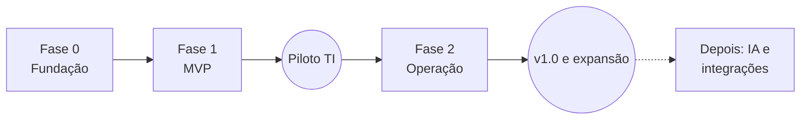

# 7. Roadmap e fases de desenvolvimento

## Premissas

- **Equipe (2026-10-10):** **uma pessoa** desenvolvendo com o Claude Code, que também faz o papel de produto e de testes. A primeira versão deste roadmap supunha 2 desenvolvedores + 1 pessoa de produto/QA; as durações abaixo foram refeitas para uma pessoa.
- **Sprints** continuam sendo os blocos de entrega, na ordem fixa. A duração de cada um é uma estimativa e é revista ao fim da Fase 0, com o ritmo real medido, e depois a cada sprint.
- Cada item abaixo vira uma linha no `TAREFAS.md` do repositório ([12.1](12-processo-de-desenvolvimento.md#121-repositório-e-tarefas)). Os códigos (ex.: `F1-S3-02`) servem para rastrear.

## Visão geral

| Fase | Sprints | Duração | Resultado | Marco |
|------|---------|---------|-----------|-------|
| **0. Fundação** | 1 | 2–3 sem. | Repositório, verificação local, esqueletos backend e frontend, banco | M0: "roda no meu computador e passa na verificação" |
| **1. MVP** | 2–5 | 10–14 sem. | Chamados de ponta a ponta com login local, grupos, setores atendidos, permissões, anexos e e-mail | **M1: piloto com a TI** |
| **2. Operação completa** | 6–8 | 8–10 sem. | Notificações no sistema, MFA, aprovações, relatórios, base de conhecimento | **M2: versão 1.0 e expansão para outras equipes** |

**Total estimado:** 20 a 27 semanas (~5 a 6 meses) até a versão 1.0. O piloto começa entre o 3º e o 4º mês. A faixa diminui depois da Fase 0, quando houver ritmo medido.

A integração com IA e outros itens ficaram para depois da v1.0 (revisão de escopo de 2026-10-09; ver [Backlog futuro](#backlog-futuro-fora-da-v10)).

---

## Fase 0 — Fundação (Sprint 1)

**Objetivo:** o ambiente sobe com um comando, a verificação local passa e o servidor de produção consegue receber o código.

| Código | Entrega |
|--------|---------|
| F0-01 | Repositório local: `TAREFAS.md` com os itens deste roadmap, `CHANGELOG.md`, `.gitignore` ([12.1](12-processo-de-desenvolvimento.md#121-repositório-e-tarefas)) |
| F0-02 | Monorepo `backend/` + `frontend/`; README com "como rodar" |
| F0-03 | Backend: `pyproject.toml` (uv), FastAPI com `/health`, configuração com pydantic-settings, logs estruturados (structlog), tratamento de erros (RFC 9457) |
| F0-04 | Banco: SQLAlchemy 2 + Alembic; migração inicial com extensões (`unaccent`, `pg_trgm`, `citext`) e a configuração de busca `pt_br` |
| F0-05 | Frontend: Vue 3 + TypeScript + Vite + Tailwind + Reka UI; Vue Router, Pinia, TanStack Query, vue-i18n |
| F0-06 | Design system inicial conforme a [identidade visual](17-identidade-visual.md): cores, tipografia, espaçamento (tokens do Tailwind), modo claro e escuro; componentes base: Botão, Campo, Select, Modal, Toast, Tabela, Badge de status |
| F0-07 | Layout do aplicativo: menu lateral, cabeçalho, área de conteúdo, responsivo |
| F0-08 | Geração do cliente TypeScript a partir do OpenAPI (`pnpm gen:api`) + verificação do contrato no `scripts/check.sh` |
| F0-09 | `docker-compose.yml` só para desenvolvimento (PostgreSQL 17, Mailpit); arquivos do systemd (serviços e timer de backup) e do nginx; `scripts/deploy.sh` e `scripts/backup.sh` ([18](18-manual-do-servidor.md)) |
| F0-10 | `scripts/check.sh` (rápido, padrão e completo, com testes em **PG 16 e 17**) e hook de pre-commit ([12.3](12-processo-de-desenvolvimento.md#123-verificação-local-no-lugar-do-ci)) |

**Pronto quando:** `docker compose up` + `pnpm dev` mostram a tela inicial da SPA consumindo o `/health`, e `scripts/check.sh --completo` passa nas duas versões do PostgreSQL.

---

## Fase 1 — MVP (Sprints 2 a 5)

**Objetivo:** a equipe de TI consegue receber e atender **todos** os seus chamados pelo sistema.

### Sprint 2 — Identidade e organização

| Código | Entrega | Referência |
|--------|---------|------------|
| F1-S2-01 | Login local, sessões no servidor, CSRF, logout | [09](09-login-e-autenticacao.md) |
| F1-S2-02 | Comando `chamados admin create`; convite e "esqueci a senha" por e-mail | [09](09-login-e-autenticacao.md#94-convite-esqueci-a-senha-e-troca-de-senha) |
| F1-S2-03 | Proteção contra força bruta (rate limit + bloqueio temporário) | 09 |
| F1-S2-04 | Cadastro de **setores atendidos** (árvore) | [08](08-organizacao-e-permissoes.md) |
| F1-S2-05 | Cadastro de **grupos** (membros + supervisores) | 08 |
| F1-S2-06 | Cadastro de **usuários** (papel, grupos) com convite por e-mail | 08 |
| F1-S2-07 | **Motor de permissões**: catálogo, papéis fixos e `can()` + testes tabelados | [08](08-organizacao-e-permissoes.md#83-catálogo-de-permissões) |
| F1-S2-08 | Log de auditoria (`audit_log`) para login e administração | 08 |
| F1-S2-09 | Telas: login, redefinição de senha, administração de usuários, grupos e setores | — |

### Sprint 3 — Núcleo dos chamados

| Código | Entrega | Referência |
|--------|---------|------------|
| F1-S3-01 | Cadastro de **categorias** (árvore, grupo padrão, tipo padrão, confidencial) | [08](08-organizacao-e-permissoes.md#81-conceitos) |
| F1-S3-02 | Status padrão e **motor de transições** (quem pode, campos exigidos) | [10.5](10-chamados.md#105-status-e-fluxo) |
| F1-S3-03 | **Registro** de chamado: formulário, setor e pessoa atendidos, responsável na criação, matriz impacto × urgência | [10.3](10-chamados.md#103-prioridade-impacto--urgência), [10.4](10-chamados.md#104-registro) |
| F1-S3-04 | **Observadores** e @menções | [10.7](10-chamados.md#107-observadores) |
| F1-S3-05 | Roteamento por categoria → grupo | 10.4 |
| F1-S3-06 | **Comentários**; edição em 10 min | [10.6](10-chamados.md#regras-de-edição) |
| F1-S3-07 | Assumir, atribuir, **transferir** (com motivo) | [10.6](10-chamados.md#106-como-a-equipe-trabalha) |
| F1-S3-08 | **Histórico** (`ticket_events`) e linha do tempo | — |
| F1-S3-09 | Telas: novo chamado e detalhe do chamado | [13](13-telas-e-navegacao.md) |
| F1-S3-10 | `ticket_visibility_filter()` + testes tabelados das regras de visibilidade (saiu da S2-07: depende da tabela de chamados) | [08](08-organizacao-e-permissoes.md#84-regras-de-visibilidade-de-chamados) |
| F1-S3-11 | **Configurações**: idioma (português e inglês, padrão do sistema + escolha de cada usuário), as 3 cores com ajuste de contraste e logotipo (pedido de 2026-10-10) | [13](13-telas-e-navegacao.md#133-lista-de-telas), [17](17-identidade-visual.md#172-cores) |

### Sprint 4 — Anexos, notificações, filas e busca

| Código | Entrega | Referência |
|--------|---------|------------|
| F1-S4-01 | **Upload em duas etapas**, validação de tipo e tamanho, armazenamento local | [11](11-anexos-e-arquivos.md) |
| F1-S4-02 | Download com verificação de permissão; imagens coladas no editor | 11 |
| F1-S4-03 | **Outbox + worker + fila de tarefas** no PostgreSQL | [03](03-arquitetura.md#eventos-de-domínio) |
| F1-S4-04 | **Notificações por e-mail** (templates em pt-BR) | [10.10](10-chamados.md#1010-notificações) |
| F1-S4-05 | **Filas**: não atribuídos, meus chamados, com novidades, aguardando, acompanhando, todos do grupo | 10.6 |
| F1-S4-06 | Botão "Pegar o próximo" | 10.6 |
| F1-S4-07 | **Busca textual** em português + filtros | — |
| F1-S4-08 | Indicador de colisão ("Fulano está vendo") + `ETag` | 10.6 |

### Sprint 5 — Ciclo completo e preparação do piloto

| Código | Entrega | Referência |
|--------|---------|------------|
| F1-S5-01 | Aguardar, concluir (texto + código), **reabrir**, cancelar | 10.5 |
| F1-S5-02 | Status personalizados criados pelo administrador (com `kind`) | [10.5](10-chamados.md#105-status-e-fluxo) |
| F1-S5-03 | Ocultar comentário ou anexo com motivo | [10.6](10-chamados.md#regras-de-edição) |
| F1-S5-04 | Testes ponta a ponta (Playwright) dos fluxos principais | — |
| F1-S5-05 | Revisão de segurança (OWASP ASVS nível 2, itens aplicáveis) e de acessibilidade | — |
| F1-S5-06 | Instalação no servidor da empresa (systemd, nginx, PostgreSQL 17), backup testado com restauração | [18](18-manual-do-servidor.md) |
| F1-S5-07 | Carga inicial da empresa: grupos, usuários, setores atendidos, categorias | [15](15-estrutura-inicial.md) |
| F1-S5-08 | Treinamento, guia rápido e virada da TI | [16](16-implantacao.md) |

Com a mudança de modelo (2026-10-10), a Fase 1 perdeu o portal do solicitante, a abertura em nome de outra pessoa, a visão do gestor de setor, as respostas prontas e a importação por CSV. A duração foi mantida: a folga absorve imprevistos antes do piloto.

**Pronto quando (M1):** a TI usa o sistema em produção por 2 semanas depois da virada, sem trabalho fora dele e sem bugs críticos abertos ([16.3](16-implantacao.md#163-cronograma)).

---

## Fase 2 — Operação completa (Sprints 6 a 8)

**Objetivo:** o sistema está pronto para RH, Financeiro e as demais áreas da empresa, com MFA para administradores e aprovações. Ao fim desta fase sai a **versão 1.0**.

### Sprint 6 — Notificações, MFA e aprovações

| Código | Entrega |
|--------|---------|
| F2-S6-01 | Notificações no sistema (sino) + preferências de notificação |
| F2-S6-02 | MFA por TOTP + códigos de recuperação; obrigatório para administradores |
| F2-S6-03 | Gerenciamento de sessões pelo usuário e pelo admin |
| F2-S6-04 | **Aprovações** pelo supervisor do grupo, lembretes |

### Sprint 7 — Enriquecimento dos chamados e conhecimento

| Código | Entrega |
|--------|---------|
| F2-S7-01 | Vínculos e **mesclagem** de duplicados |
| F2-S7-02 | Ações em massa |
| F2-S7-03 | Gestão de membros do grupo pelo supervisor |
| F2-S7-04 | Base de conhecimento da equipe (artigos, busca, artigo a partir de um chamado concluído) |

### Sprint 8 — Relatórios e versão 1.0

| Código | Entrega |
|--------|---------|
| F2-S8-01 | Painéis e relatórios conforme [14](14-relatorios-e-indicadores.md); exportação CSV |
| F2-S8-02 | Implantação nas outras equipes ([16.10](16-implantacao.md#1610-expansão-para-outras-equipes-fase-2-m2)) |
| F2-S8-03 | Preparação da v1.0: testes ponta a ponta completos, revisão de segurança, guia do administrador |

**Pronto quando (M2 / v1.0):** pelo menos 3 equipes além da TI usando o sistema e relatórios em uso.

---

## Backlog futuro (fora da v1.0)

O desenho de banco destes itens está em [`esboco-schema-futuro.sql`](esboco-schema-futuro.sql).

**Retirados na revisão de escopo (2026-10-09):**

- **Integração com IA** (classificação, resumo, sugestão de resposta, busca semântica, duplicados, deflexão, artigos gerados). A arquitetura continua preparada; o plano completo está em [Integração com IA](06-integracao-ia.md). Estimativa anterior: ~10 semanas
- Servidor MCP para agentes de IA externos
- Tokens de API com escopos e webhooks de saída
- Papéis personalizados
- Visões salvas e atalhos de teclado
- Antivírus nos anexos (ClamAV)
- Campos extras por categoria (formulários dinâmicos)

**Retirados com a mudança de modelo (2026-10-10):** só fazem sentido se um dia os colaboradores tiverem conta.

- Portal do solicitante: catálogo de abertura, "Meus chamados", comentários públicos × notas internas, sugestão de artigos na abertura
- Abertura e resposta por e-mail (IMAP)
- Pesquisa de satisfação
- Visão e aprovação pelo gestor de setor
- Respostas prontas (macros)
- Importação de usuários por CSV

**Outros:**

- Chamados filhos / subtarefas (ex.: admissão de colaborador gera chamados para TI, RH e Facilities)
- Aprovação em vários níveis e delegação por férias
- Automações configuráveis ("se X então Y")
- Distribuição automática (rodízio, menor carga)
- SSO (OIDC) e mapeamento de grupos do provedor de identidade, se a empresa adotar um diretório de contas ([09](09-login-e-autenticacao.md))
- SCIM para provisionamento de usuários, LDAP direto, passkeys
- Armazenamento de anexos em S3
- Bot no Teams e no Slack
- Atualização em tempo real por Server-Sent Events
- PWA / notificações push no celular

## Riscos principais

| Risco | Mitigação |
|-------|-----------|
| Regras de permissão complexas gerando vazamento de dados | Função única de visibilidade + testes tabelados obrigatórios desde a Sprint 2 |
| Desenvolvedor único: indisponibilidade ou conhecimento concentrado | Documentação em `docs/`, testes automatizados, `TAREFAS.md` sempre atualizado e decisões registradas em ADR |
| Código só na máquina de desenvolvimento | `git push` frequente para o repositório de passagem do servidor ([18.3](18-manual-do-servidor.md#5-código)), que também entra no backup |
| Escopo do MVP crescer | Tudo que não está na Fase 1 vai para o backlog. O critério de M1 é "a TI consegue operar", não "tem todas as funções" |
| A equipe registrar só parte do trabalho | Virada com data marcada, combinados da equipe e acompanhamento diário nas duas primeiras semanas ([16](16-implantacao.md)) |
