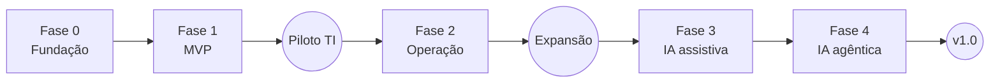

# 7. Roadmap e fases de desenvolvimento

## Premissas

- **Equipe de referência:** 2 desenvolvedores full stack (Python + Vue) + 1 pessoa dividida entre produto, QA e design. Com outra composição, as durações mudam.
- **Sprints de 2 semanas.** No GitHub: cada **fase** é um *milestone* e cada sprint é uma *iteração* no GitHub Projects (ver [processo de desenvolvimento](12-processo-de-desenvolvimento.md)).
- As estimativas são revistas ao fim de cada sprint. A ordem das fases é fixa; o conteúdo de cada sprint pode ser rearranjado dentro da fase.
- Cada item abaixo vira uma ou mais *issues* no GitHub. Os códigos (ex.: `F1-S3-02`) servem para rastrear.

## Visão geral

| Fase | Sprints | Duração | Resultado | Marco |
|------|---------|---------|-----------|-------|
| **0. Fundação** | 1 | 2 sem. | Repositório, CI, esqueletos backend e frontend, banco | M0: "roda no meu computador e no CI" |
| **1. MVP** | 2–5 | 8 sem. | Chamados de ponta a ponta com login local, setores, grupos, permissões, anexos e e-mail | **M1: piloto com a TI** |
| **2. Operação completa** | 6–8 | 6 sem. | MFA, aprovações, e-mail de entrada, relatórios, base de conhecimento, API pública | **M2: expansão para outras áreas** |
| **3. IA assistiva** | 9–11 | 6 sem. | Classificação, resumo, sugestão de resposta, busca semântica | M3: IA em modo sugestão |
| **4. IA agêntica e autoatendimento** | 12–13 | 4 sem. | Servidor MCP, deflexão no portal, artigos gerados de chamados | M4: versão 1.0 |

**Total estimado:** 26 semanas (~6 meses) até a versão 1.0. O piloto começa com cerca de 2 meses e meio.

---

## Fase 0 — Fundação (Sprint 1)

**Objetivo:** qualquer pessoa da equipe clona o repositório, sobe o ambiente com um comando e faz push na `main` com o CI verde.

| Código | Entrega |
|--------|---------|
| F0-01 | Repositório no GitHub: templates de issue, labels, Dependabot, GitHub Projects |
| F0-02 | Monorepo `backend/` + `frontend/`; README com "como rodar" |
| F0-03 | Backend: `pyproject.toml` (uv), FastAPI com `/health`, configuração com pydantic-settings, logs estruturados (structlog), tratamento de erros (RFC 9457) |
| F0-04 | Banco: SQLAlchemy 2 + Alembic; migração inicial com extensões (`pgvector`, `unaccent`, `pg_trgm`, `citext`) e a configuração de busca `pt_br` |
| F0-05 | Frontend: Vue 3 + TypeScript + Vite + Tailwind + Reka UI; Vue Router, Pinia, TanStack Query, vue-i18n |
| F0-06 | Design system inicial: cores, tipografia, espaçamento (tokens do Tailwind), modo claro e escuro; componentes base: Botão, Campo, Select, Modal, Toast, Tabela, Badge de status |
| F0-07 | Layout do aplicativo: menu lateral, cabeçalho, área de conteúdo, responsivo |
| F0-08 | Geração do cliente TypeScript a partir do OpenAPI (`pnpm gen:api`) + verificação no CI |
| F0-09 | `docker-compose.yml` só para desenvolvimento (PostgreSQL 17 + pgvector, Mailpit); arquivos de exemplo do systemd e do nginx; `scripts/deploy.sh` |
| F0-10 | GitHub Actions: lint, tipos e testes do backend em **PG 16 e 17**; lint, tipos, testes e build do frontend |

**Pronto quando:** `docker compose up` + `pnpm dev` mostram a tela inicial da SPA consumindo o `/health`, e o CI roda nas duas versões do PostgreSQL.

---

## Fase 1 — MVP (Sprints 2 a 5)

**Objetivo:** a equipe de TI consegue receber e atender **todos** os seus chamados pelo sistema.

### Sprint 2 — Identidade e organização

| Código | Entrega | Referência |
|--------|---------|------------|
| F1-S2-01 | Login local, sessões no servidor, CSRF, logout | [09](09-login-e-autenticacao.md) |
| F1-S2-02 | Comando `chamados admin create`; convite e "esqueci a senha" por e-mail | [09](09-login-e-autenticacao.md#94-convite-esqueci-a-senha-e-troca-de-senha) |
| F1-S2-03 | Proteção contra força bruta (rate limit + bloqueio temporário) | 09 |
| F1-S2-04 | Cadastro de **setores** (árvore + gestores) | [08](08-organizacao-e-permissoes.md) |
| F1-S2-05 | Cadastro de **grupos de atendimento** (membros + supervisores) | 08 |
| F1-S2-06 | Cadastro de **usuários** (papel, setor) + importação CSV | 08 |
| F1-S2-07 | **Motor de permissões**: catálogo, papéis fixos, `can()` e `ticket_visibility_filter()` + testes tabelados | [08](08-organizacao-e-permissoes.md#84-regras-de-visibilidade-de-chamados) |
| F1-S2-08 | Log de auditoria (`audit_log`) para login e administração | 08 |
| F1-S2-09 | Telas: login, redefinição de senha, administração de usuários, setores e grupos | — |

### Sprint 3 — Núcleo dos chamados

| Código | Entrega | Referência |
|--------|---------|------------|
| F1-S3-01 | Cadastro de **categorias** (árvore, grupo padrão, tipo padrão, confidencial) | [08](08-organizacao-e-permissoes.md#81-conceitos) |
| F1-S3-02 | Status padrão e **motor de transições** (quem pode, campos exigidos) | [10.5](10-chamados.md#105-status-e-fluxo) |
| F1-S3-03 | **Abertura** pelo portal: catálogo, formulário, matriz impacto × urgência | [10.3](10-chamados.md#103-prioridade-impacto--urgência), [10.4](10-chamados.md#104-abertura) |
| F1-S3-04 | Abertura **em nome de outra pessoa** (telefone, presencial) | 10.4 |
| F1-S3-05 | Roteamento por categoria → grupo | 10.4 |
| F1-S3-06 | **Comentários** públicos e notas internas; edição em 10 min | [10.7](10-chamados.md#107-experiência-do-solicitante) |
| F1-S3-07 | Assumir, atribuir, **transferir** (com motivo) | [10.6](10-chamados.md#106-como-o-agente-trabalha) |
| F1-S3-08 | **Histórico** (`ticket_events`) e linha do tempo | — |
| F1-S3-09 | Telas: abrir chamado, "Meus chamados" (solicitante), detalhe do chamado (solicitante e agente) | [13](13-telas-e-navegacao.md) |

### Sprint 4 — Anexos, notificações, filas e busca

| Código | Entrega | Referência |
|--------|---------|------------|
| F1-S4-01 | **Upload em duas etapas**, validação de tipo e tamanho, armazenamento local | [11](11-anexos-e-arquivos.md) |
| F1-S4-02 | Download com verificação de permissão; imagens coladas no editor | 11 |
| F1-S4-03 | **Outbox + worker + fila de tarefas** no PostgreSQL | [03](03-arquitetura.md#eventos-de-domínio) |
| F1-S4-04 | **Notificações por e-mail** (templates em pt-BR) | [10.10](10-chamados.md#1010-notificações) |
| F1-S4-05 | **Visões do agente**: não atribuídos, meus chamados, aguardando minha ação, aguardando cliente, entregues, todos do grupo | 10.6 |
| F1-S4-06 | Botão "Pegar o próximo" | 10.6 |
| F1-S4-07 | **Busca textual** em português + filtros | — |
| F1-S4-08 | Indicador de colisão ("Fulano está vendo") + `ETag` | 10.6 |

### Sprint 5 — Ciclo completo e preparação do piloto

| Código | Entrega | Referência |
|--------|---------|------------|
| F1-S5-01 | Entregar (solução + código), concluir, **reabrir**, cancelar | 10.5 |
| F1-S5-02 | Status personalizados criados pelo administrador (com `kind`) | [10.5](10-chamados.md#105-status-e-fluxo) |
| F1-S5-03 | Visão do **gestor de setor** (chamados do setor, somente leitura) | 08 |
| F1-S5-04 | Respostas prontas (pessoais e do grupo) | 10.6 |
| F1-S5-05 | Ocultar comentário ou anexo com motivo | 10.7 |
| F1-S5-06 | Testes ponta a ponta (Playwright) dos fluxos principais | — |
| F1-S5-07 | Revisão de segurança (OWASP ASVS nível 2, itens aplicáveis) e de acessibilidade | — |
| F1-S5-08 | Instalação no servidor da Martiniti (systemd, nginx, PostgreSQL 17), guia de atualização, backup do banco + arquivos | [ADR 0010](adr/0010-producao-systemd.md) |
| F1-S5-09 | Carga inicial da Martiniti: setores, grupos, categorias, usuários | [15](15-estrutura-martiniti.md) |

**Pronto quando (M1):** a TI usa o sistema em produção por 2 semanas sem precisar de outro canal, sem bugs críticos abertos.

---

## Fase 2 — Operação completa (Sprints 6 a 8)

**Objetivo:** o sistema está pronto para RH, Facilities, Financeiro e outras áreas, com MFA para administradores e aprovações.

### Sprint 6 — Notificações, MFA e aprovações

| Código | Entrega |
|--------|---------|
| F2-S6-01 | Notificações no sistema (sino) + preferências de notificação |
| F2-S6-02 | Atalhos de teclado e visões salvas |
| F2-S6-03 | MFA por TOTP + códigos de recuperação; obrigatório para administradores |
| F2-S6-04 | Gerenciamento de sessões pelo usuário e pelo admin |
| F2-S6-05 | **Aprovações** (gestor, usuário específico, grupo), lembretes, redirecionamento |

### Sprint 7 — E-mail e enriquecimento dos chamados

| Código | Entrega |
|--------|---------|
| F2-S7-01 | E-mail de entrada (IMAP e/ou Microsoft Graph) → abertura e resposta de chamados |
| F2-S7-02 | Campos extras por categoria (formulários dinâmicos) |
| F2-S7-03 | Observadores, vínculos, **mesclagem** de duplicados |
| F2-S7-04 | Avaliação de satisfação |
| F2-S7-05 | Ações em massa |
| F2-S7-06 | Antivírus (ClamAV) |

### Sprint 8 — Relatórios, conhecimento e API pública

| Código | Entrega |
|--------|---------|
| F2-S8-01 | Painéis e relatórios conforme [14](14-relatorios-e-indicadores.md); exportação CSV |
| F2-S8-02 | Base de conhecimento (artigos internos e públicos, busca, sugestão na abertura) |
| F2-S8-03 | Tokens de API com escopos, `Idempotency-Key`, rate limit |
| F2-S8-04 | Webhooks de saída assinados |
| F2-S8-05 | Papéis personalizados |
| F2-S8-06 | Gestão de membros do grupo pelo supervisor |

**Pronto quando (M2):** pelo menos 3 áreas além da TI operando e relatórios de atendimento em uso.

---

## Fase 3 — IA assistiva (Sprints 9 a 11)

Detalhes em [Integração com IA](06-integracao-ia.md).

| Sprint | Entregas |
|--------|----------|
| **9** | Cliente genérico de IA (chat + embeddings); cadastro de endpoints e funcionalidades; `ai_runs`; mascaramento de dados pessoais; bloqueio por categoria; embeddings + busca semântica e híbrida |
| **10** | Classificação automática (modo sugestão); chamados semelhantes / duplicados; painel de sugestões na tela do agente; feedback (aceitar, editar, rejeitar) |
| **11** | Resumo do chamado (inclusive na transferência); sugestão de resposta com RAG e fontes; painel de qualidade e consumo; evals no CI |

**Pronto quando (M3):** taxa de aceitação da classificação ≥ 70% por 4 semanas, e o sistema funciona normalmente com a IA desligada.

## Fase 4 — IA agêntica e autoatendimento (Sprints 12 e 13)

| Sprint | Entregas |
|--------|----------|
| **12** | Servidor MCP; contas de serviço para agentes de IA; deflexão no portal (artigos sugeridos pela IA antes de abrir) |
| **13** | Rascunho de artigo a partir de chamado resolvido; classificação com aplicação automática onde a qualidade justificar; extração de texto de anexos (opcional); preparação da v1.0 |

---

## Backlog futuro (fora da v1.0)

- Chamados filhos / subtarefas (ex.: admissão de colaborador gera chamados para TI, RH e Facilities)
- Aprovação em vários níveis e delegação por férias
- Automações configuráveis ("se X então Y")
- Distribuição automática (rodízio, menor carga)
- SSO (OIDC) e mapeamento de grupos do provedor de identidade, se a Martiniti adotar um diretório de contas ([09](09-login-e-autenticacao.md))
- SCIM para provisionamento de usuários, LDAP direto, passkeys
- Armazenamento de anexos em S3
- Bot no Teams e no Slack
- Atualização em tempo real por Server-Sent Events
- PWA / notificações push no celular

## Riscos principais

| Risco | Mitigação |
|-------|-----------|
| Regras de permissão complexas gerando vazamento de dados | Função única de visibilidade + testes tabelados obrigatórios desde a Sprint 2 |
| Escopo do MVP crescer | Tudo que não está na Fase 1 vai para o backlog. O critério de M1 é "a TI consegue operar", não "tem todas as funções" |
| Adoção baixa pelos colaboradores | Portal simples, abertura por e-mail na Fase 2, piloto com feedback semanal |
| Qualidade da IA variar entre modelos | Evals no CI; modo sugestão por padrão; métricas de aceitação |
