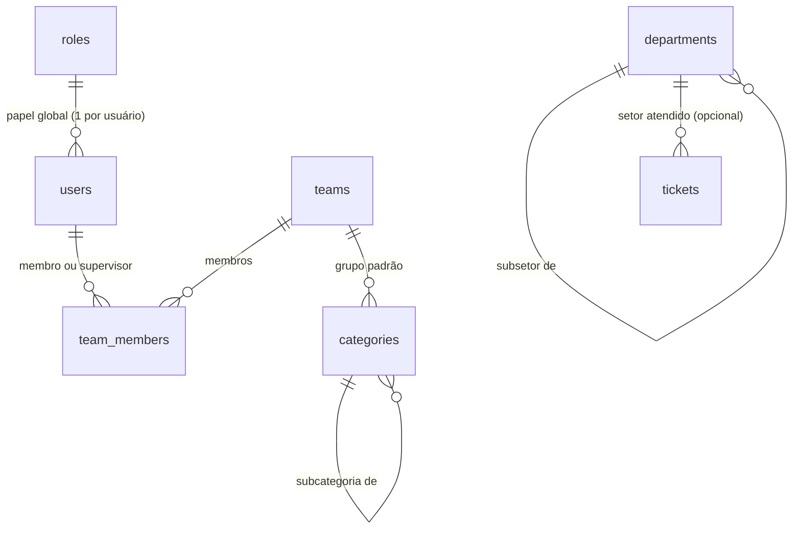

# 8. Organização, grupos, setores e permissões

Este documento define **quem é quem** no sistema e **quem pode fazer o quê**. As regras daqui são a referência para o motor de permissões do backend e para os testes de permissão.

> **Modelo (decisão de 2026-10-10):** o TicketFlow é a **ferramenta de trabalho das equipes**. Só os membros das equipes têm conta: eles mesmos registram os chamados (as tarefas da equipe), distribuem entre si e acompanham. Os demais colaboradores da empresa **não** entram no sistema; quando uma tarefa é para alguém de fora, o chamado só registra o setor e o nome da pessoa atendida, para os relatórios.

## 8.1 Conceitos

| Conceito | Nome no código | O que é | Exemplos |
|----------|----------------|---------|----------|
| **Grupo** | `team` | Equipe que registra e executa chamados. Cada grupo tem uma fila. | TI – Suporte; TI – Infraestrutura; RH – Departamento Pessoal |
| **Setor atendido** | `department` | Área da empresa **para a qual** a tarefa é feita. Só um cadastro para os relatórios: ninguém faz login como setor. | Financeiro › Contas a Pagar; Comercial; RH |
| **Categoria** | `category` | **O que** é a tarefa. Árvore de até 3 níveis. | TI › Acessos › Novo acesso a sistema; TI › Equipamentos › Instalação |
| **Papel** | `role` | Conjunto de permissões **globais** do usuário | Agente, Administrador, Auditor |
| **Atribuição contextual** | — | Permissão extra que vale só em um contexto | Supervisor *de um grupo*, observador *de um chamado* |

### Regras da estrutura

- Todo usuário tem **exatamente um papel global** e é membro de **pelo menos um grupo** (exceto o auditor, que pode não ter grupo).
- Em cada grupo, o usuário é `member` ou `supervisor`. Um grupo pode ter vários supervisores.
- Um grupo tem: nome, categorias atendidas, forma de aviso de chamado novo e se está ativo.
- Uma categoria tem: grupo padrão, tipo padrão (incidente, requisição, tarefa), se exige aprovação do supervisor e se é **confidencial**.
- Setores, grupos e categorias **não são apagados**, só desativados, para preservar o histórico e os relatórios.

## 8.2 Papéis globais

| Papel | Para quem | Resumo |
|-------|-----------|--------|
| **Agente** (`agent`) | Membros das equipes | Registra e trabalha os chamados dos **grupos de que é membro** |
| **Administrador** (`admin`) | Responsáveis pelo sistema | Configura tudo; vê todos os chamados |
| **Auditor** (`auditor`) | Compliance, controle interno | **Leitura** de tudo (chamados e auditoria), sem alterar nada |

### Atribuições contextuais (somam-se ao papel)

| Atribuição | Como se ganha | O que acrescenta |
|------------|---------------|------------------|
| **Supervisor de grupo** | `team_members.role = 'supervisor'` | No seu grupo: atribui chamados a qualquer membro, **aprova** chamados das categorias que exigem aprovação, vê relatórios do grupo e (Fase 2) adiciona e remove membros |
| **Observador** | Adicionado ao chamado por um colega, ou se adiciona sozinho | Vê o chamado, comenta e recebe as atualizações, mesmo sendo de outro grupo |

### Papéis personalizados (futuro)

Na v1.0 os papéis são fixos. Depois da v1.0, o administrador poderá criar papéis combinando permissões do catálogo abaixo (ex.: "Agente somente leitura"). Os papéis do sistema não podem ser editados nem excluídos.

## 8.3 Catálogo de permissões

As permissões são códigos fixos definidos no código (`core/permissions.py`). Um papel é uma lista desses códigos.

### Chamados

| Código | Permite |
|--------|---------|
| `ticket.create` | Registrar chamado em um dos próprios grupos |
| `ticket.view_team` | Ver chamados dos grupos de que é membro |
| `ticket.view_all` | Ver todos os chamados (inclusive de outros grupos) |
| `ticket.comment` | Comentar (todos os comentários são visíveis a quem vê o chamado) |
| `ticket.edit` | Alterar título, descrição, categoria, tipo, setor e pessoa atendidos e tags |
| `ticket.set_priority` | Alterar impacto, urgência e prioridade |
| `ticket.assign_self` | Assumir um chamado ("pegar para mim") |
| `ticket.assign_others` | Atribuir a outro membro do grupo |
| `ticket.transfer` | Transferir para outro grupo |
| `ticket.transition` | Mudar status (respeitando o [fluxo](10-chamados.md#105-status-e-fluxo)) |
| `ticket.approve` | Aprovar ou reprovar chamados que aguardam aprovação |
| `ticket.watch` | Adicionar e remover observadores |
| `ticket.merge` | Mesclar duplicados e vincular chamados |
| `ticket.bulk` | Ações em massa |
| `ticket.hide_content` | Ocultar comentário ou anexo (com motivo; o conteúdo fica na auditoria) |
| `ticket.export` | Exportar listas de chamados (CSV) |

### Base de conhecimento, relatórios e administração

| Código | Permite |
|--------|---------|
| `kb.read` | Ler artigos |
| `kb.write` | Criar e editar artigos (rascunho) |
| `kb.publish` | Publicar e arquivar artigos |
| `report.view_team` | Relatórios dos próprios grupos |
| `report.view_all` | Relatórios de todos os grupos |
| `admin.users` | Usuários: criar, desativar, alterar papel |
| `admin.organization` | Grupos, membros e setores atendidos |
| `admin.catalog` | Categorias, tipos e status (inclusive criar novos status) |
| `admin.settings` | Configurações gerais e identidade visual |
| `audit.view` | Log de auditoria (logins, mudanças de configuração e de permissão) |

Futuro: `admin.roles` (papéis personalizados), `admin.integrations` (tokens de API e webhooks) e `admin.ai` (endpoints e funcionalidades de IA).

### Permissões de cada papel padrão

| Permissão | Agente | Admin | Auditor |
|-----------|:-:|:-:|:-:|
| `ticket.create` | ✅ | ✅ | — |
| `ticket.view_team` | ✅ | ✅ | ✅ |
| `ticket.view_all` | — | ✅ | ✅ |
| `ticket.comment` | ✅ | ✅ | — |
| `ticket.edit` | ✅ | ✅ | — |
| `ticket.set_priority` | ✅ | ✅ | — |
| `ticket.assign_self` | ✅ | ✅ | — |
| `ticket.assign_others` | ✅ | ✅ | — |
| `ticket.transfer` | ✅ | ✅ | — |
| `ticket.transition` | ✅ | ✅ | — |
| `ticket.approve` | 👤 | ✅ | — |
| `ticket.watch` | ✅ | ✅ | — |
| `ticket.merge` | ✅ | ✅ | — |
| `ticket.bulk` | 👤 | ✅ | — |
| `ticket.hide_content` | 👤 | ✅ | — |
| `ticket.export` | 👤 | ✅ | ✅ |
| `kb.read` | ✅ | ✅ | ✅ |
| `kb.write` | ✅ | ✅ | — |
| `kb.publish` | 👤 | ✅ | — |
| `report.view_team` | 👤 | ✅ | ✅ |
| `report.view_all` | — | ✅ | ✅ |
| `admin.*` | — | ✅ | — |
| `audit.view` | — | ✅ | ✅ |

**Legenda:** ✅ sim · — não · 👤 só para quem é **supervisor** do grupo do chamado

## 8.4 Regras de visibilidade de chamados

Um usuário **vê** um chamado se **pelo menos uma** condição for verdadeira:

| # | Condição |
|---|----------|
| 1 | É membro do **grupo atual** do chamado |
| 2 | É membro de um grupo que **já atuou** no chamado (antes de uma transferência) |
| 3 | É o **responsável** atual |
| 4 | É **observador** (inclui quem foi mencionado com `@nome`, que vira observador automaticamente) |
| 5 | Tem `ticket.view_all` e a categoria **não** é confidencial |
| 6 | É **administrador** ou **auditor**. O acesso a chamados confidenciais fica registrado na auditoria |

Todos os comentários e anexos são visíveis a quem vê o chamado: não existe mais a separação entre comentário público e nota interna, porque não há solicitante de fora da equipe.

**Casos importantes:**

- **Categorias confidenciais** (ex.: RH › Folha de pagamento) ficam restritas às regras 1, 3, 4 e 6. Grupos que atuaram antes de uma transferência deixam de ver, e `ticket.view_all` não basta.
- Depois de uma transferência, os membros do grupo anterior **continuam vendo** o chamado (regra 2), mas não podem mais alterá-lo.
- **Alterar** um chamado exige vê-lo **e** ser membro do grupo atual (ou admin), além da permissão específica. Observadores de outros grupos só comentam.

### Implementação

- Existe **uma única função** que gera o filtro de visibilidade: `ticket_visibility_filter(user) → cláusula SQL`. Ela é usada em **todos** os lugares que leem chamados: listas, detalhe, busca, relatórios, exportação e anexos. Quando entrarem, a busca semântica, a IA, os webhooks e o servidor MCP também vão usá-la.
- A decisão sobre uma ação é tomada por `can(user, action, ticket) → bool`, sempre nos *services*, nunca só no frontend. O frontend usa a lista de ações permitidas que a API devolve (`"allowed_actions": [...]` no detalhe do chamado) só para mostrar ou esconder botões.
- Os testes de permissão são **tabelados**: para cada linha das matrizes acima existe um caso de teste com usuários de cada perfil.

## 8.5 O que cada perfil pode alterar em um chamado

| Campo | Membro do grupo | Supervisor do grupo | Observador de outro grupo |
|-------|-----------------|---------------------|---------------------------|
| Título, descrição, categoria, tipo | Sim | Sim | — |
| Setor e pessoa atendidos | Sim | Sim | — |
| Impacto, urgência e prioridade | Sim, com motivo se forçar outra prioridade | Sim | — |
| Grupo (transferência) | Sim, com motivo | Sim | — |
| Responsável | Assumir para si; devolver para a fila | Qualquer membro do grupo | — |
| Status | Conforme o fluxo | Conforme o fluxo + aprovar | — |
| Observadores | Sim | Sim | Remover a si mesmo |
| Tags | Sim | Sim | — |
| Comentários | Sim | Sim | Sim |

Toda alteração gera um evento no histórico do chamado com autor, data, valor anterior e valor novo.

## 8.6 Administração delegada

| Quem | Pode administrar |
|------|------------------|
| **Administrador** | Tudo |
| **Supervisor de grupo** | (Fase 2) membros do grupo |

## 8.7 Origem dos dados de organização

- **Cadastro manual** pela tela de administração. Com até 50 usuários, não há importação por CSV.
- **Login SSO** (futuro, se a empresa adotar um diretório de contas): papel e grupos podem ser preenchidos a partir dos grupos do Entra ID / Google / Keycloak, conforme [Login e autenticação → mapeamento](09-login-e-autenticacao.md#96-mapeamento-de-grupos-do-provedor-de-identidade)

Cada vínculo de grupo guarda a origem (`source = 'manual' | 'idp'`). Vínculos vindos do provedor de identidade são sincronizados a cada login; vínculos manuais não são removidos pela sincronização.

## 8.8 Auditoria de organização e permissões

São registradas em `audit_log`: criação e desativação de usuários, mudança de papel, entrada e saída de grupos, mudança de supervisores e toda mudança de configuração. Cada registro guarda autor, data, IP, valor anterior e valor novo.
