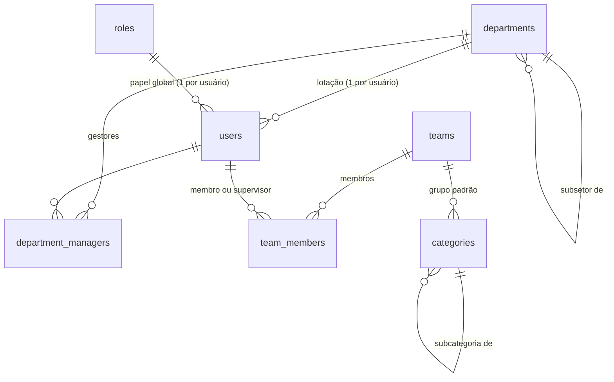

# 8. Organização, grupos, setores e permissões

Este documento define **quem é quem** no sistema e **quem pode fazer o quê**. As regras daqui são a referência para o motor de permissões do backend e para os testes de permissão.

## 8.1 Conceitos

| Conceito | Nome no código | O que é | Exemplos |
|----------|----------------|---------|----------|
| **Setor** | `department` | Unidade da empresa onde a pessoa **trabalha**. Forma uma árvore. | Financeiro › Contas a Pagar; Comercial › Vendas SP; RH |
| **Grupo de atendimento** | `team` | Equipe que **atende** chamados. Cada grupo tem uma fila. | TI – Service Desk (N1); TI – Infraestrutura (N2); RH – Departamento Pessoal; Facilities |
| **Categoria** | `category` | **O que** está sendo pedido ou relatado (catálogo de serviços). Árvore de até 3 níveis. | TI › Acessos › Redefinir senha; Facilities › Manutenção › Ar-condicionado |
| **Papel** | `role` | Conjunto de permissões **globais** do usuário | Solicitante, Agente, Administrador, Auditor |
| **Atribuição contextual** | — | Permissão extra que vale só em um contexto | Gestor *de um setor*, supervisor *de um grupo*, observador *de um chamado* |

> **Setor × grupo:** setor é *de onde a pessoa é*; grupo é *o que a pessoa atende*. Um analista de TI pertence ao setor "TI" e pode ser membro dos grupos "Service Desk" e "Infraestrutura". Uma analista de RH que atende chamados pertence ao setor "RH" e é membro do grupo "RH – Atendimento". A maioria dos colaboradores tem um setor e nenhum grupo.

### Regras da estrutura

- Todo usuário tem **exatamente um setor** e **exatamente um papel global**.
- Um usuário pode ser membro de **vários grupos**. Em cada grupo ele é `member` ou `supervisor`.
- Um setor pode ter **vários gestores**. Um gestor enxerga o seu setor **e os subsetores**.
- Um grupo tem: nome, e-mail de entrada (opcional), calendário de expediente (para o SLA), categorias atendidas e se está ativo.
- Uma categoria tem: grupo padrão, tipo padrão (incidente, requisição, dúvida), formulário de campos extras, se exige aprovação, se é **confidencial** e se permite IA.
- Setores, grupos e categorias **não são apagados**, só desativados, para preservar o histórico e os relatórios.
- O chamado guarda o **setor do solicitante no momento da abertura** (`tickets.department_id`). Se a pessoa mudar de setor, os relatórios antigos continuam corretos.

## 8.2 Papéis globais

| Papel | Para quem | Resumo |
|-------|-----------|--------|
| **Solicitante** (`requester`) | Todo colaborador | Abre, acompanha e responde os **próprios** chamados |
| **Agente** (`agent`) | Quem atende chamados | Trabalha os chamados dos **grupos de que é membro** |
| **Administrador** (`admin`) | Responsáveis pelo sistema | Configura tudo; vê todos os chamados |
| **Auditor** (`auditor`) | Compliance, controle interno | **Leitura** de tudo (chamados, notas internas, auditoria), sem alterar nada |

### Atribuições contextuais (somam-se ao papel)

| Atribuição | Como se ganha | O que acrescenta |
|------------|---------------|------------------|
| **Gestor de setor** | Cadastrado como gestor do setor | Vê os chamados abertos por pessoas do seu setor e subsetores (exceto categorias confidenciais) e é o aprovador padrão das requisições do setor |
| **Supervisor de grupo** | `team_members.role = 'supervisor'` | No seu grupo: atribui chamados a qualquer membro, vê relatórios, gerencia respostas prontas e (Fase 2) adiciona e remove membros |
| **Observador** | Adicionado ao chamado | Vê o chamado (só a parte pública) e recebe notificações |
| **Aprovador** | Designado em uma aprovação | Vê o chamado (parte pública) e aprova ou reprova |

### Papéis personalizados (Fase 2)

Na Fase 1 os quatro papéis são fixos. Na Fase 2 o administrador pode criar papéis combinando permissões do catálogo abaixo (ex.: "Agente N1 sem permissão de cancelar", "Agente somente leitura"). Os papéis do sistema não podem ser editados nem excluídos.

## 8.3 Catálogo de permissões

As permissões são códigos fixos definidos no código (`core/permissions.py`). Um papel é uma lista desses códigos.

### Chamados

| Código | Permite |
|--------|---------|
| `ticket.create` | Abrir chamado para si |
| `ticket.create_on_behalf` | Abrir chamado em nome de outra pessoa (atendimento por telefone ou presencial) |
| `ticket.view_team` | Ver chamados dos grupos de que é membro |
| `ticket.view_all` | Ver todos os chamados (inclusive de outros grupos) |
| `ticket.view_internal` | Ver notas internas e anexos internos (em chamados que já pode ver) |
| `ticket.comment` | Comentar publicamente |
| `ticket.note_internal` | Escrever nota interna |
| `ticket.edit` | Alterar título, descrição, categoria, tipo, tags e campos extras |
| `ticket.set_priority` | Alterar impacto, urgência e prioridade |
| `ticket.assign_self` | Assumir um chamado ("pegar para mim") |
| `ticket.assign_others` | Atribuir a outro membro do grupo |
| `ticket.transfer` | Transferir para outro grupo |
| `ticket.transition` | Mudar status (respeitando o [fluxo](10-chamados.md#105-status-e-fluxo)) |
| `ticket.cancel` | Cancelar chamado de outra pessoa |
| `ticket.merge` | Mesclar duplicados e vincular chamados |
| `ticket.bulk` | Ações em massa |
| `ticket.hide_content` | Ocultar comentário ou anexo (com motivo; o conteúdo fica na auditoria) |
| `ticket.export` | Exportar listas de chamados (CSV) |

### Base de conhecimento, relatórios e administração

| Código | Permite |
|--------|---------|
| `kb.read_internal` | Ler artigos internos (só para agentes) |
| `kb.write` | Criar e editar artigos (rascunho) |
| `kb.publish` | Publicar e arquivar artigos |
| `report.view_team` | Relatórios dos próprios grupos |
| `report.view_all` | Relatórios de todos os grupos e setores |
| `admin.users` | Usuários: criar, desativar, alterar papel e setor |
| `admin.organization` | Setores, grupos e membros |
| `admin.catalog` | Categorias, formulários, tipos e status |
| `admin.sla` | Calendários e políticas de SLA |
| `admin.roles` | Papéis personalizados (Fase 2) |
| `admin.integrations` | Tokens de API, webhooks, e-mail de entrada, SSO |
| `admin.ai` | Endpoints e funcionalidades de IA |
| `admin.settings` | Configurações gerais e identidade visual |
| `audit.view` | Log de auditoria (logins, mudanças de configuração e de permissão) |

### Permissões de cada papel padrão

| Permissão | Solicitante | Agente | Admin | Auditor |
|-----------|:-:|:-:|:-:|:-:|
| `ticket.create` | ✅ | ✅ | ✅ | — |
| `ticket.create_on_behalf` | — | ✅ | ✅ | — |
| `ticket.view_team` | — | ✅ | ✅ | ✅ |
| `ticket.view_all` | — | ⚙️ | ✅ | ✅ |
| `ticket.view_internal` | — | ✅ | ✅ | ✅ |
| `ticket.comment` | ✅¹ | ✅ | ✅ | — |
| `ticket.note_internal` | — | ✅ | ✅ | — |
| `ticket.edit` | ✅² | ✅ | ✅ | — |
| `ticket.set_priority` | — | ✅ | ✅ | — |
| `ticket.assign_self` | — | ✅ | ✅ | — |
| `ticket.assign_others` | — | 👤 | ✅ | — |
| `ticket.transfer` | — | ✅ | ✅ | — |
| `ticket.transition` | ✅³ | ✅ | ✅ | — |
| `ticket.cancel` | ✅⁴ | ✅ | ✅ | — |
| `ticket.merge` | — | ✅ | ✅ | — |
| `ticket.bulk` | — | 👤 | ✅ | — |
| `ticket.hide_content` | — | 👤 | ✅ | — |
| `ticket.export` | — | 👤 | ✅ | ✅ |
| `kb.read_internal` | — | ✅ | ✅ | ✅ |
| `kb.write` | — | ✅ | ✅ | — |
| `kb.publish` | — | 👤 | ✅ | — |
| `report.view_team` | — | 👤 | ✅ | ✅ |
| `report.view_all` | — | — | ✅ | ✅ |
| `admin.*` | — | — | ✅ | — |
| `audit.view` | — | — | ✅ | ✅ |

**Legenda:** ✅ sim · — não · 👤 só para quem é **supervisor** do grupo do chamado · ⚙️ depende da configuração "agentes veem chamados de outros grupos" (padrão: **não**)
¹ só nos chamados que pode ver · ² só nos próprios chamados e só até o atendimento começar · ³ só as transições do solicitante: confirmar solução, reabrir, cancelar · ⁴ só os próprios chamados, antes de resolvidos

## 8.4 Regras de visibilidade de chamados

Um usuário **vê** um chamado se **pelo menos uma** condição for verdadeira:

| # | Condição | Vê notas internas? |
|---|----------|:-:|
| 1 | É o **solicitante** | Não |
| 2 | **Abriu** o chamado em nome de alguém | Só se for agente de um grupo com acesso (regra 6) |
| 3 | É **observador** | Não |
| 4 | É **aprovador** (pendente ou que já decidiu) | Não |
| 5 | É **gestor do setor** do chamado ou de um setor acima, e a categoria **não** é confidencial | Não |
| 6 | É membro do **grupo atual** do chamado ou de um grupo que **já atendeu** o chamado | Sim |
| 7 | É o **responsável** atual | Sim |
| 8 | Tem `ticket.view_all` e a categoria **não** é confidencial | Sim |
| 9 | É **administrador** ou **auditor** | Sim, e o acesso a chamados confidenciais fica registrado na auditoria |
| 10 | Foi **mencionado** (`@nome`) em uma nota interna. Só agentes podem ser mencionados | Sim |

**Casos importantes:**

- **Notas internas nunca aparecem para o solicitante**, mesmo que ele seja agente de outro grupo. Um analista de TI que abre um chamado no RH não vê as notas internas do RH sobre o próprio chamado.
- **Categorias confidenciais** (ex.: RH › Denúncia, RH › Folha de pagamento) ficam restritas às regras 1, 6, 7, 9 e 10. O gestor do setor não vê, e `ticket.view_all` não basta.
- Depois de uma transferência, os membros do grupo anterior **continuam vendo** o chamado (regra 6), mas não podem mais alterá-lo.
- **Alterar** um chamado exige vê-lo **e** ser membro do grupo atual (ou supervisor, ou admin), além da permissão específica.

### Implementação

- Existe **uma única função** que gera o filtro de visibilidade: `ticket_visibility_filter(user) → cláusula SQL`. Ela é usada em **todos** os lugares que leem chamados: listas, detalhe, busca textual e semântica, relatórios, exportação, anexos, RAG da IA, webhooks e servidor MCP.
- A decisão sobre uma ação é tomada por `can(user, action, ticket) → bool`, sempre nos *services*, nunca só no frontend. O frontend usa a lista de ações permitidas que a API devolve (`"allowed_actions": [...]` no detalhe do chamado) só para mostrar ou esconder botões.
- Os testes de permissão são **tabelados**: para cada linha da matriz acima existe um caso de teste com usuários de cada perfil.

## 8.5 O que cada perfil pode alterar em um chamado

| Campo | Solicitante | Agente do grupo | Supervisor do grupo |
|-------|-------------|-----------------|---------------------|
| Título e descrição | Até o atendimento começar | Sim | Sim |
| Categoria e tipo | Só na abertura | Sim | Sim |
| Urgência | Na abertura | Sim | Sim |
| Impacto e prioridade | — | Sim, com motivo se mudar a prioridade calculada | Sim |
| Grupo (transferência) | — | Sim, com motivo | Sim |
| Responsável | — | Só assumir para si | Qualquer membro do grupo |
| Status | Confirmar solução, reabrir, cancelar | Conforme o fluxo | Conforme o fluxo |
| Observadores | Adicionar e remover | Sim | Sim |
| Tags e campos extras | Campos extras na abertura | Sim | Sim |

Toda alteração gera um evento no histórico do chamado com autor, data, valor anterior e valor novo.

## 8.6 Administração delegada

| Quem | Pode administrar |
|------|------------------|
| **Administrador** | Tudo |
| **Supervisor de grupo** | Respostas prontas do grupo; (Fase 2) membros do grupo e visões salvas compartilhadas do grupo |
| **Gestor de setor** | Nada de configuração; só aprova e acompanha |

## 8.7 Origem dos dados de organização

- **Cadastro manual** pela tela de administração (sempre disponível)
- **Importação CSV** de usuários e setores (Fase 1, para a carga inicial)
- **Login SSO** (Fase 2): setor, papel e grupos podem ser preenchidos a partir de atributos e grupos do Entra ID / Google / Keycloak, conforme [Login e autenticação → mapeamento](09-login-e-autenticacao.md#96-mapeamento-de-grupos-do-provedor-de-identidade)

Cada vínculo guarda a origem (`source = 'manual' | 'idp' | 'import'`). Vínculos vindos do provedor de identidade são sincronizados a cada login; vínculos manuais não são removidos pela sincronização.

## 8.8 Auditoria de organização e permissões

São registradas em `audit_log`: criação e desativação de usuários, mudança de papel, mudança de setor, entrada e saída de grupos, mudanças de gestores, criação e edição de papéis personalizados, e toda mudança de configuração. Cada registro guarda autor, data, IP, valor anterior e valor novo.
