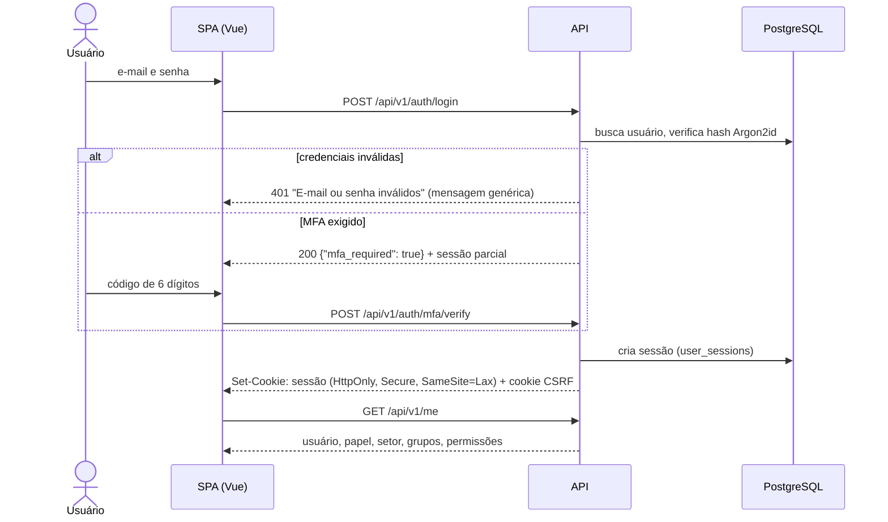
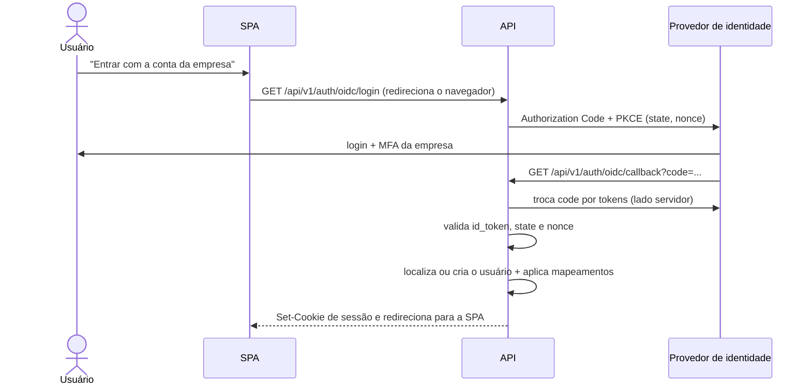

# 9. Login e autenticação

## 9.1 Formas de acesso

| Forma | Para quem | Fase |
|-------|-----------|------|
| **E-mail + senha** (login local) | Todos | 1 |
| **SSO via OIDC** (Microsoft Entra ID, Google Workspace, Keycloak, Okta…) | Todos os usuários | Futuro |
| **MFA por TOTP** (aplicativo autenticador) | Obrigatório para administradores no login local; opcional para os demais | 2 |
| **Token de API** | Integrações e agentes de IA (não é login de pessoa; ver [API](05-api.md#tokens-de-api-futuro)) | Futuro |
| LDAP / Active Directory direto | Só se a empresa não tiver OIDC | Futuro |
| Passkeys (WebAuthn) | Alternativa a senha + TOTP | Futuro |

> **Martiniti:** não há diretório de contas centralizado (Microsoft 365, Google Workspace ou AD). O login é **só por e-mail e senha**; as seções 9.5 e 9.6 ficam registradas para o futuro.

Quando o SSO existir, o administrador poderá ligar **"SSO obrigatório"**: o login local passa a valer só para administradores e para usuários marcados como exceção.

## 9.2 Primeiro acesso à instalação

1. A empresa instala o sistema no servidor ([ADR 0010](adr/0010-producao-systemd.md)).
2. O primeiro administrador é criado por linha de comando, **sem senha padrão**:
   ```bash
   sudo -u sistema-chamados uv run chamados admin create --email ti@empresa.com --name "Administrador"
   ```
   O comando mostra um link de definição de senha válido por 24 h.
3. O administrador configura grupos, setores atendidos e categorias e cadastra os usuários, que recebem um convite por e-mail.

## 9.3 Login local



### Regras

- **Senhas:** mínimo de 12 caracteres, sem regras de composição obrigatórias e sem troca periódica forçada (recomendação NIST SP 800-63B). Senhas que estão em uma lista local de senhas vazadas ou muito comuns são recusadas.
- **Hash:** Argon2id (`argon2-cffi`). Se os parâmetros mudarem, o hash é refeito no próximo login bem-sucedido.
- **Força bruta:** limite por IP e por conta. A partir de 5 falhas seguidas, cada nova tentativa espera mais; com 10 falhas, a conta fica bloqueada por 15 min e o dono recebe um e-mail.
- **Mensagens genéricas:** a tela nunca revela se o e-mail existe.
- **Usuário desativado** não consegue entrar, e as sessões dele são encerradas na hora.

## 9.4 Convite, esqueci a senha e troca de senha

| Fluxo | Como funciona |
|-------|---------------|
| **Convite** | O admin cadastra o usuário → o usuário recebe um e-mail com link para definir a senha (validade de 72 h) |
| **Esqueci a senha** | Link por e-mail com token de uso único (validade de 30 min). A resposta da tela é sempre a mesma, exista o e-mail ou não. Ao redefinir, **todas as outras sessões** são encerradas |
| **Troca de senha logado** | Exige a senha atual; encerra as outras sessões |

Os tokens de convite e redefinição ficam em `auth_tokens`, guardados só como hash SHA-256.

## 9.5 SSO via OIDC

> **Futuro.** Não se aplica à Martiniti hoje.



- O **backend** é o cliente OIDC confidencial. A SPA nunca recebe nem guarda tokens do provedor.
- **Identificação do usuário:** primeiro pelo `sub` (`users.external_id`). No primeiro login, pelo e-mail, se `email_verified` for verdadeiro e o domínio estiver na lista permitida.
- **Criação automática (JIT):** se o usuário não existir e o domínio for permitido, ele é criado com o papel padrão (Agente, sem grupo até o admin incluí-lo) e os mapeamentos são aplicados. Domínios fora da lista são recusados.
- **Configuração** (tela de administração): URL do emissor (*issuer*), client ID, referência ao segredo, domínios permitidos, nomes das *claims* (nome, e-mail, setor, grupos) e a opção "SSO obrigatório".
- **Desligamento de colaborador:** desativado no provedor, ele não consegue mais entrar. Como as sessões têm duração limitada (9.7), o acesso termina em poucas horas. A sincronização ativa (SCIM) fica para o futuro.

## 9.6 Mapeamento de grupos do provedor de identidade

> **Futuro.** Depende do SSO.

O administrador associa grupos do Entra ID / Google / Keycloak a elementos do sistema:

| Grupo no provedor | Efeito no sistema |
|-------------------|-------------------|
| `GG-Chamados-Admins` | Papel **Administrador** |
| `GG-TI-ServiceDesk` | Papel **Agente** + membro do grupo **TI – Service Desk** |
| `GG-TI-Infra-Coord` | Supervisor do grupo **TI – Infraestrutura** |
| `GG-Auditoria` | Papel **Auditor** |

- O **setor** pode vir de um atributo (ex.: `department` no Entra ID), associado a um setor cadastrado por nome ou código.
- Os mapeamentos são aplicados **a cada login**. O que vem do provedor é marcado com `source = 'idp'`: se a pessoa sair do grupo no provedor, sai também do grupo no sistema. Vínculos feitos à mão (`source = 'manual'`) não são afetados.
- Se uma pessoa estiver em mais de um grupo mapeado para papéis diferentes, vale o **papel mais alto**: Admin > Auditor > Agente.

## 9.7 Sessões

- **Sessão no servidor** (tabela `user_sessions`). O cookie só contém um identificador aleatório de 256 bits, e no banco fica o hash dele.
- **Expiração:** após 8 h sem uso ou 7 dias no máximo (ambos configuráveis).
- **Cookie:** `HttpOnly`, `Secure`, `SameSite=Lax`, `Path=/`.
- **CSRF:** um segundo cookie, legível pelo JavaScript, carrega o token CSRF. A SPA o envia no header `X-CSRF-Token` em todo `POST`, `PUT`, `PATCH` e `DELETE`, e a API compara os dois.
- **Permissões avaliadas a cada requisição:** se o papel ou os grupos de alguém mudam, o efeito é imediato, sem precisar sair e entrar de novo.
- **Gerenciamento:** o usuário vê as próprias sessões ativas (dispositivo, IP, último acesso) e pode encerrá-las. O admin pode encerrar todas as sessões de um usuário.

## 9.8 Eventos de auditoria

Ficam registrados em `audit_log`: login com sucesso, login com falha, bloqueio por tentativas, logout, encerramento de sessão, ativação e desativação de MFA, uso de código de recuperação, convite enviado, redefinição de senha, usuário criado via SSO, mudanças de configuração do SSO e, no futuro, criação e revogação de tokens de API.

## 9.9 Endpoints

| Método | Rota | Descrição |
|--------|------|-----------|
| `POST` | `/auth/login` | Login local |
| `POST` | `/auth/mfa/verify` | Segundo fator |
| `POST` | `/auth/logout` | Encerra a sessão atual |
| `POST` | `/auth/password/forgot` | Solicita redefinição |
| `POST` | `/auth/password/reset` | Redefine com token |
| `POST` | `/auth/invite/accept` | Define senha no primeiro acesso |
| `GET` | `/auth/oidc/login` | Inicia o SSO (futuro) |
| `GET` | `/auth/oidc/callback` | Retorno do provedor |
| `GET` | `/me` | Dados do usuário logado, grupos e permissões |
| `POST` | `/me/password` | Troca de senha |
| `GET` / `DELETE` | `/me/sessions[/{id}]` | Lista e encerra sessões |
| `POST` / `DELETE` | `/me/mfa` | Ativa e desativa TOTP |
