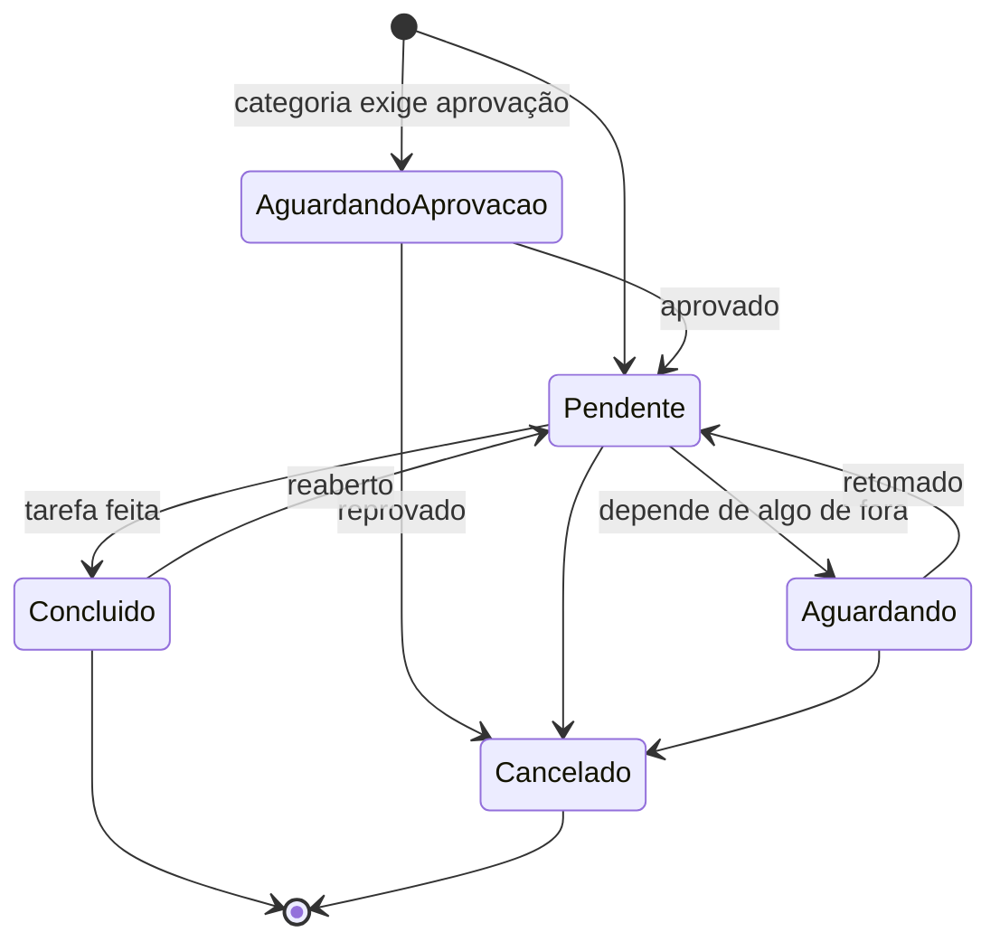

# 10. Como funcionam os chamados

Este documento descreve o ciclo de vida de um chamado. No TicketFlow, um chamado é uma **tarefa da equipe**: quem registra e quem executa são membros dos grupos ([modelo](08-organizacao-e-permissoes.md)). As permissões citadas estão em [Organização e permissões](08-organizacao-e-permissoes.md).

## 10.1 Anatomia de um chamado

| Campo | Descrição | Quem define |
|-------|-----------|-------------|
| Número | `#1234`, sequencial, nunca reutilizado | Sistema |
| Título e descrição | O que precisa ser feito (Markdown) | Quem registra |
| Tipo | Incidente, requisição ou tarefa (10.2) | Padrão da categoria; ajustável |
| Categoria | O que é a tarefa | Quem registra |
| Grupo | Fila responsável | Categoria (padrão) ou quem registra; muda por transferência |
| Responsável | Membro que está executando | Quem registra (pode ser ele mesmo), quem assume ou o supervisor |
| Registrado por | Membro que criou o chamado | Sistema |
| Setor atendido | Área para a qual a tarefa é feita (opcional) | Quem registra |
| Pessoa atendida | Nome de quem pediu ou será atendido, em texto livre, sem conta no sistema (opcional) | Quem registra |
| Status | Etapa do ciclo de vida (10.5) | Fluxo |
| Impacto, urgência e prioridade | 10.3 | Quem registra; ajustável |
| Observadores | Colegas que acompanham | Qualquer membro do grupo |
| Tags | Marcadores livres | Membros do grupo |
| Vínculos | Duplicado de, relacionado a, bloqueado por | Membros do grupo |
| Anexos | Ver [Anexos e arquivos](11-anexos-e-arquivos.md) | Quem comenta |
| Resolução | Código + texto do que foi feito | Quem conclui |

## 10.2 Tipos de chamado

| Tipo | Quando usar | Exemplo |
|------|-------------|---------|
| **Incidente** | Algo que funcionava parou ou está com defeito | "ERP fora do ar no Financeiro" |
| **Requisição** | Alguém de fora da equipe pediu algo | "Criar acesso à pasta do Comercial para a Carla" |
| **Tarefa** | Trabalho planejado ou de rotina da própria equipe | "Trocar o switch do 2º andar", "Renovar o certificado do site" |

O tipo vem da categoria e pode ser corrigido. Ele é usado nos relatórios. Os nomes são uma proposta e a equipe pode ajustá-los ([questões em aberto](questoes-em-aberto.md)).

## 10.3 Prioridade: impacto × urgência

Quem registra responde duas perguntas, e o sistema calcula a prioridade:

- **Urgência:** "Para quando?" → *Pode esperar* / *Nesta semana* / *Agora*
- **Impacto:** "Quem é afetado?" → *Uma pessoa* / *Um setor ou equipe* / *A empresa toda ou clientes*

| Impacto \ Urgência | Baixa | Média | Alta |
|--------------------|-------|-------|------|
| **Individual** | Baixa | Baixa | Média |
| **Setor / equipe** | Baixa | Média | Alta |
| **Empresa / clientes** | Média | Alta | **Crítica** |

- Mudar o impacto ou a urgência recalcula a prioridade.
- É possível **forçar** outra prioridade, mas é preciso informar o motivo, que fica no histórico.
- A matriz é configurável pelo administrador.

## 10.4 Registro

### Como um chamado nasce

| Origem | Como funciona | Fase |
|--------|---------------|------|
| **Formulário** | Um membro registra pelo botão "Novo chamado", sempre visível | 1 |
| **API / integrações** | `POST /tickets` com token de API | Futuro |
| **Agente de IA / MCP** | Via API ou servidor MCP | Futuro |

Pedidos que chegam por fora (telefone, conversa, mensagem) são registrados por quem os recebeu, preenchendo o **setor** e a **pessoa atendida**.

### Formulário

```
Grupo*         [TI – Suporte ▾]            (só os grupos de que sou membro)
Categoria*     [TI › Acessos › Novo acesso ▾]   (filtrada pelo grupo; busca por texto)
Título*        [______________________________________]
Descrição      [ editor de texto (colar prints)       ]
Para quem      Setor [Comercial ▾]   Pessoa [Carla Dias      ]   (opcionais)
Urgência       ( ) Pode esperar  ( ) Nesta semana  ( ) Agora
Impacto        ( ) Uma pessoa  ( ) Um setor  ( ) A empresa toda
Responsável    (•) Eu  ( ) Deixar na fila  ( ) Outro membro (supervisor)
Observadores   [+ adicionar colega]
📎 Arraste arquivos aqui ou clique para anexar
                                                   [Cancelar] [Registrar]
```

Ao registrar:

1. O sistema calcula a prioridade e grava quem registrou.
2. Se a categoria **exige aprovação**, o chamado nasce em "Aguardando aprovação" e os supervisores do grupo são avisados (10.8).
3. Senão, nasce em **Pendente**, com o responsável escolhido ou na fila do grupo.
4. O grupo é avisado conforme a configuração dele: só a fila, ou e-mail para todos os membros.

## 10.5 Status e fluxo

> As etapas abaixo são o **padrão proposto** e ainda serão discutidas pela equipe. O administrador pode criar outras.

### Status padrão

| Status | `kind` | Significado |
|--------|--------|-------------|
| **Pendente** | `open` | Em aberto: na fila do grupo (sem responsável) ou em execução |
| **Aguardando** | `waiting` | Parado por algo de fora: outra pessoa, peça, fornecedor, janela de manutenção |
| **Concluído** | `closed` | Final. A tarefa foi feita |
| **Cancelado** | `canceled` | Final. Não era necessário, era duplicado ou foi reprovado |

**Status criados pelo administrador:** cada um tem um nome e um `kind`: `open`, `waiting`, `closed`, `canceled` ou `approval` (usado nas aprovações, 10.8). As regras do sistema dependem do `kind`, não do nome. Exemplos: "Em andamento" (`open`), "Aguardando aprovação" (`approval`). Entre status do mesmo `kind`, muda-se livremente.

**Nada muda de status sozinho com o passar do tempo.** Concluir é sempre uma ação de uma pessoa.

### Diagrama



### Transições: quem pode e o que é exigido

| De | Para | Quem | Exigências / efeitos |
|----|------|------|----------------------|
| Aprovação (`approval`) | Pendente | Supervisor do grupo | Comentário opcional |
| Aprovação (`approval`) | Cancelado | Supervisor do grupo | **Motivo obrigatório** |
| Pendente | Aguardando | Responsável ou supervisor | **Comentário obrigatório**: o que se está esperando |
| Aguardando | Pendente | Membro do grupo | Manual |
| Pendente | Concluído | Responsável ou supervisor | **Texto do que foi feito + código de resolução** obrigatórios |
| Concluído | Pendente | Membro do grupo | **Motivo obrigatório**. Contador de reaberturas +1. Volta para o mesmo responsável |
| Qualquer não final | Cancelado | Quem registrou, responsável ou supervisor | **Motivo obrigatório** (duplicado → usar mesclagem) |
| Cancelado | — | — | Final. O botão "Novo chamado relacionado" cria um chamado vinculado |

### Códigos de resolução

Feito · Feito com solução de contorno · Não reproduzível · Fora do escopo do grupo. A lista é configurável e serve para os relatórios.

## 10.6 Como a equipe trabalha

### Visões (filas) padrão

| Visão | Conteúdo | Para quem |
|-------|----------|-----------|
| **Não atribuídos** | Chamados dos meus grupos sem responsável | Todos |
| **Meus chamados** | Chamados em que sou o responsável, ainda abertos | Todos |
| **Com novidades** | Meus chamados com comentário novo de outra pessoa, recém-aprovados ou reabertos | Todos |
| **Aguardando** | Chamados dos meus grupos parados em `waiting` | Todos |
| **Acompanhando** | Chamados em que sou observador | Todos |
| **Todos do grupo** | Tudo do grupo, com filtro por responsável e status | Todos |
| **Aprovações** | Chamados aguardando a minha aprovação | Supervisores (Fase 2) |

**Ordenação padrão:** primeiro a prioridade, depois a data de registro (mais antigo primeiro).

**Indicadores na lista:** prioridade (cor e texto), ícone de "novidade", responsável, setor atendido, há quanto tempo está parado.

### Distribuição do trabalho

- **Para si:** quem registra já pode ficar como responsável, o caso mais comum quando a pessoa vai executar a tarefa.
- **Puxar:** o membro clica em **"Pegar o próximo"**, e o sistema atribui o primeiro chamado da fila "Não atribuídos" na ordenação padrão. Também é possível assumir um chamado específico.
- **Empurrar:** o supervisor atribui chamados a membros do grupo, individualmente ou em massa.
- **Automática** (futuro): por rodízio ou menor carga.

### Tela do chamado

```
┌──────────────────────────────────────────────────────────────────────────────┐
│ #1234  Impressora do 3º andar não imprime     [Pendente ▾] [Alta]            │
│ Registrado há 2h10 por Bruno  ·  Ana também está vendo                       │
├───────────────────────────────────────────────┬──────────────────────────────┤
│ LINHA DO TEMPO                                │ Grupo: TI – Suporte          │
│ ● Bruno · 09:02                               │ Responsável: Ana             │
│   Financeiro avisou por telefone: "offline"   │ Categoria: TI › Impressão    │
│ ◦ Sistema · atribuído a Ana · 09:15           │ Tipo: Incidente              │
│ ● Ana · 09:20                                 │ Para: Financeiro · João Silva│
│   Verificar o switch do andar                 │──────────────────────────────│
│ ● Ana · 09:25 · @Carlos                       │ Observadores: Bruno, Carlos  │
│   Carlos, consegue olhar a porta 12?          │ Tags · Vínculos              │
│                                               │ Anexos (2)                   │
├───────────────────────────────────────────────┤                              │
│ ┌───────────────────────────────────────────┐ │                              │
│ │ Escreva um comentário…                    │ │                              │
│ └───────────────────────────────────────────┘ │                              │
│ 📎 Anexar                                     │                              │
│ [Comentar]  [Comentar e concluir ▾]           │                              │
└───────────────────────────────────────────────┴──────────────────────────────┘
```

- **Comentar e mudar status:** o comentário e a mudança de status saem numa única ação (ex.: "Comentar e concluir", "Comentar e aguardar").
- **Menções:** `@nome` notifica o colega, que vira observador do chamado.
- **Colisão:** o sistema mostra quem mais está com o chamado aberto. Se chegou um comentário novo depois que a tela foi carregada, aparece um aviso antes de enviar. Alterações de campos usam `ETag` para não sobrescrever a mudança de outra pessoa.
- **Rascunho automático:** o texto em edição é salvo localmente no navegador e restaurado se a página for recarregada.
- **Histórico do setor:** acesso rápido aos últimos chamados do mesmo setor atendido.

### Transferência

| Situação | Como funciona |
|----------|---------------|
| **Transferência** (ex.: Suporte → Infraestrutura) | Escolhe-se o grupo de destino e escreve-se um **motivo obrigatório**, que vira comentário. O chamado continua **Pendente**, na fila do novo grupo e sem responsável. O grupo anterior mantém acesso de leitura |
| **Pedir ajuda sem transferir** | Comentário com `@menção` a um colega de outro grupo, que vira observador |

### Duplicados e vínculos

- **Mesclar:** o chamado secundário é **cancelado** com o código "Duplicado" e vinculado ao principal (`duplicate_of`). Os observadores do secundário passam para o principal. Os conteúdos não são movidos: o vínculo permite consultar os dois.
- **Relacionado a / bloqueado por:** só informativos, exibidos nos dois chamados.

### Ações em massa (supervisor ou permissão `ticket.bulk`)

Atribuir, transferir, mudar prioridade, adicionar tag, concluir com o mesmo texto (ex.: incidente geral resolvido) e adicionar comentário.

### Regras de edição

- Comentários podem ser editados pelo autor por **10 minutos**. As versões anteriores ficam no histórico.
- **Ninguém apaga comentários.** Com `ticket.hide_content`, um comentário ou anexo pode ser **ocultado**, com motivo, e o original continua na auditoria (ex.: alguém colou uma senha).

## 10.7 Observadores

- Qualquer membro do grupo adiciona colegas como observadores; qualquer usuário pode se adicionar a um chamado que já vê.
- Observadores de **outros grupos** veem o chamado e comentam, mas não alteram campos nem status.
- O observador recebe as atualizações (10.10) e encontra os chamados na visão **Acompanhando**.

## 10.8 Aprovações (Fase 2)

- Ativadas **por categoria** (`requires_approval`), para tarefas que precisam do "ok" antes de começar (ex.: compra de equipamento).
- **Quem aprova:** os **supervisores do grupo** do chamado. Se houver vários, qualquer um decide.
- Se quem registrou for supervisor do grupo, o chamado já nasce aprovado, e isso fica no histórico.
- Se o grupo não tiver supervisor, a aprovação vai para os administradores.
- O supervisor recebe um aviso com link e decide na tela: **Aprovar** (comentário opcional) ou **Reprovar** (motivo obrigatório).
- Para usar aprovações, o administrador cria um status com `kind = approval` (ex.: "Aguardando aprovação"). Ele não faz parte dos status padrão.
- Lembretes após 1 e 3 dias.
- Um nível de aprovação. Vários níveis ficam para o futuro.

## 10.9 Prazos: sem SLA

Não há SLA: não existem metas de prazo, alertas de vencimento nem calendário de expediente (decisão de 2026-10-09). O sistema só **mede** os tempos (até alguém assumir, até concluir) para os relatórios.

## 10.10 Notificações

| Evento | Responsável | Observadores | Grupo | Supervisores | Outros |
|--------|:-:|:-:|:-:|:-:|---|
| Chamado registrado sem responsável | | | ✉️/🔔 conforme o grupo | | |
| Atribuído a alguém | ✉️🔔 | | | | |
| Aguardando aprovação | | | | ✉️🔔 | |
| Aprovado / reprovado | 🔔 | 🔔 | | | Quem registrou 🔔 |
| Comentário novo | 🔔 | 🔔 | | | |
| @menção | | | | | Mencionado ✉️🔔 |
| Transferido | | | 🔔 novo grupo | | |
| Concluído | | ✉️🔔 | | | Quem registrou 🔔 |
| Reaberto | ✉️🔔 | 🔔 | | | |

✉️ e-mail · 🔔 notificação dentro do sistema (Fase 2). Na Fase 1, enquanto o sino não existe, os eventos marcados só com 🔔 também vão por e-mail. Quem causou o evento nunca é notificado dele. Cada usuário escolhe nas preferências como quer receber, exceto atribuição, menção e aprovação pendente, que não podem ser desligadas.

## 10.11 Rotinas automáticas (worker)

| Rotina | Frequência |
|--------|------------|
| Lembrar supervisores de aprovações pendentes | Diária |
| Limpar uploads não vinculados há mais de 24 h | Diária |

Nenhuma rotina muda o status de um chamado.
