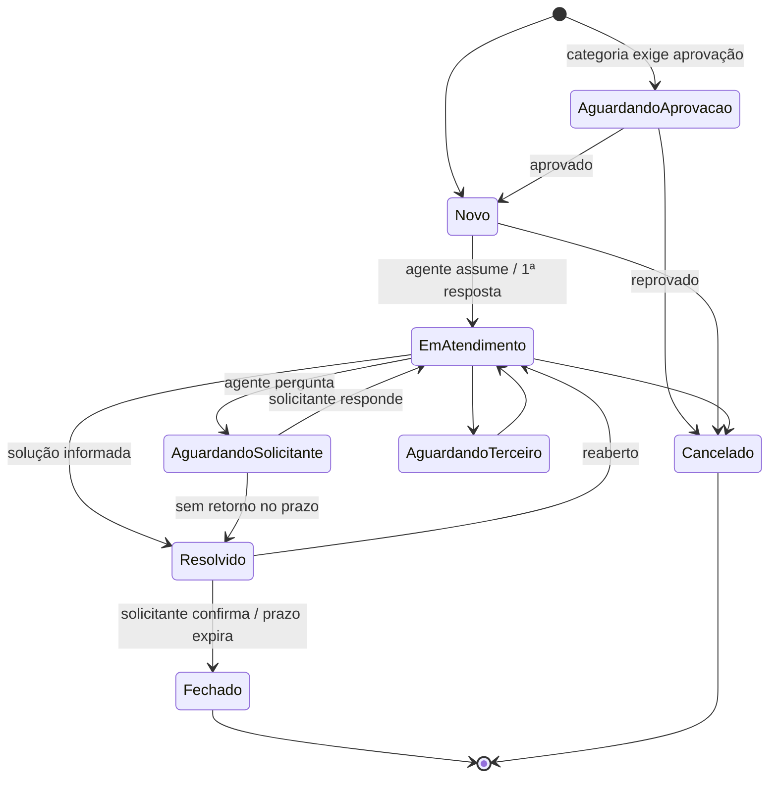

# 10. Como funcionam os chamados

Este documento descreve o ciclo de vida de um chamado, do ponto de vista de quem pede e de quem atende. As permissões citadas estão em [Organização e permissões](08-organizacao-e-permissoes.md).

## 10.1 Anatomia de um chamado

| Campo | Descrição | Quem define |
|-------|-----------|-------------|
| Número | `#1234`, sequencial, nunca reutilizado | Sistema |
| Título e descrição | O que está acontecendo ou sendo pedido (Markdown) | Solicitante |
| Tipo | Incidente, requisição ou dúvida (10.2) | Padrão da categoria; agente ajusta |
| Categoria | Item do catálogo de serviços | Solicitante; agente ajusta |
| Campos extras | Definidos pela categoria (ex.: patrimônio, sistema, centro de custo) | Solicitante |
| Solicitante | Quem precisa do atendimento | Sistema (usuário logado) ou agente, ao abrir em nome de alguém |
| Aberto por | Quem registrou, se diferente do solicitante | Sistema |
| Setor | Setor do solicitante **no momento da abertura** | Sistema |
| Grupo | Fila responsável | Categoria (roteamento); agente transfere |
| Responsável | Agente que está atendendo | Agente assume ou supervisor atribui |
| Status | Etapa do ciclo de vida (10.5) | Fluxo |
| Impacto, urgência e prioridade | 10.3 | Solicitante informa a urgência; agente define o impacto |
| Canal | Portal, e-mail, telefone, presencial, API ou agente de IA | Sistema |
| Observadores | Pessoas que acompanham | Solicitante e agentes |
| Tags | Marcadores livres | Agentes |
| Vínculos | Duplicado de, relacionado a, bloqueado por | Agentes |
| Anexos | Ver [Anexos e arquivos](11-anexos-e-arquivos.md) | Todos que comentam |
| SLA | Prazos de 1ª resposta e de resolução (10.9) | Política de SLA |
| Resolução | Código + texto da solução | Agente |
| Avaliação | Nota de 1 a 5 + comentário | Solicitante |

## 10.2 Tipos de chamado

| Tipo | Quando usar | Exemplo | Efeito |
|------|-------------|---------|--------|
| **Incidente** | Algo que funcionava parou ou está com defeito | "Não consigo acessar o ERP" | SLA mais curto; foco em restaurar o serviço |
| **Requisição** | Pedido de algo novo ou de uma mudança padrão | "Acesso à pasta do Financeiro", "Notebook para novo colaborador" | Pode exigir **aprovação** (10.8) |
| **Dúvida** | Orientação, sem nada quebrado | "Como configuro a assinatura de e-mail?" | SLA mais longo; boa candidata a artigo da base de conhecimento |

O tipo vem da categoria e o agente pode corrigi-lo. Ele é usado nas políticas de SLA e nos relatórios.

## 10.3 Prioridade: impacto × urgência

O solicitante não escolhe "prioridade" diretamente, porque todo mundo escolheria "alta". Ele responde duas perguntas simples:

- **Urgência:** "Isso impede seu trabalho?" → *Posso esperar* / *Atrapalha, mas consigo trabalhar* / *Estou parado*
- **Impacto:** "Quem é afetado?" → *Só eu* / *Meu setor ou equipe* / *A empresa toda ou clientes*

| Impacto \ Urgência | Baixa | Média | Alta |
|--------------------|-------|-------|------|
| **Individual** | Baixa | Baixa | Média |
| **Setor / equipe** | Baixa | Média | Alta |
| **Empresa / clientes** | Média | Alta | **Crítica** |

- O agente pode corrigir o impacto e a urgência; a prioridade é recalculada.
- O agente pode **forçar** outra prioridade, mas precisa informar o motivo, que fica no histórico.
- A matriz é configurável pelo administrador.

## 10.4 Abertura

### Canais

| Canal | Como funciona | Fase |
|-------|---------------|------|
| **Portal** | Formulário guiado (abaixo) | 1 |
| **Em nome de alguém** | O agente registra um atendimento por telefone ou presencial, escolhendo o solicitante. O canal fica como `phone` ou `walk_in` | 1 |
| **E-mail** | Mensagem para o endereço de um grupo (ex.: `ti@empresa.com`) vira chamado na categoria padrão desse grupo. Remetente que não é usuário recebe uma resposta automática explicando como acessar o portal | 2 |
| **API / integrações** | `POST /tickets` com token de API | 2 |
| **Agente de IA / MCP** | Via API ou servidor MCP, identificado como `ai_agent` | 4 |

### Formulário guiado do portal

```
1. "Do que você precisa?"  → busca + árvore do catálogo (categorias com ícone e descrição)
2. Artigos sugeridos        → "Isso resolve?" (deflexão; reforçada por IA na Fase 4)
3. Formulário               → título, descrição, campos extras da categoria, urgência, impacto, anexos
4. Confirmação              → número do chamado, prazo previsto de 1ª resposta (a partir da Fase 2), link para acompanhar
```

Ao enviar o formulário:

1. O sistema calcula a prioridade, define o grupo pela categoria e grava o setor do solicitante.
2. Se a categoria **exige aprovação**, o chamado nasce em **Aguardando aprovação** (10.8).
3. Senão, nasce em **Novo** e o SLA começa a contar.
4. O solicitante recebe a confirmação por e-mail.
5. O grupo é notificado conforme a configuração do grupo: e-mail para todos os membros ou só a fila.

## 10.5 Status e fluxo

### Status padrão

| Status | `kind` | Pausa o SLA? | Significado |
|--------|--------|:-:|-------------|
| **Aguardando aprovação** | `approval` | Não conta¹ | Requisição esperando o aprovador |
| **Novo** | `new` | Não | Na fila do grupo, ninguém assumiu ainda |
| **Em atendimento** | `open` | Não | Um agente está trabalhando |
| **Aguardando solicitante** | `pending` | **Sim** | Agente pediu informação ou teste ao solicitante |
| **Aguardando terceiro** | `pending` | Configurável (padrão: **não**) | Depende de fornecedor ou de outra área externa |
| **Resolvido** | `resolved` | — | Agente informou a solução; aguardando confirmação |
| **Fechado** | `closed` | — | Final. Não pode ser reaberto |
| **Cancelado** | `canceled` | — | Final. Não era necessário, era duplicado ou foi reprovado |

¹ O SLA só começa a contar depois da aprovação.

O administrador pode **renomear** status e **criar** novos (ex.: "Aguardando peça"), mas todo status pertence a um dos `kind` acima. As regras do sistema dependem do `kind`, não do nome.

### Diagrama



### Transições: quem pode e o que é exigido

| De | Para | Quem | Exigências / efeitos |
|----|------|------|----------------------|
| Aguardando aprovação | Novo | Aprovador | Comentário opcional. O SLA começa |
| Aguardando aprovação | Cancelado | Aprovador | **Motivo obrigatório**, enviado ao solicitante |
| Novo | Em atendimento | Agente do grupo | Automático quando o agente assume o chamado ou envia o 1º comentário público |
| Em atendimento | Aguardando solicitante | Responsável | **Comentário público obrigatório** (a pergunta) |
| Aguardando solicitante | Em atendimento | Solicitante (automático) | Volta sozinho quando o solicitante responde |
| Aguardando solicitante | Resolvido | Sistema | Após N dias úteis sem resposta (padrão: 5), com lembrete no 2º dia. Código: "Sem retorno do solicitante" |
| Em atendimento | Aguardando terceiro | Responsável | **Nota interna obrigatória** (com quem, protocolo externo) |
| Aguardando terceiro | Em atendimento | Responsável | — |
| Em atendimento | Resolvido | Responsável | **Solução (texto público) + código de resolução obrigatórios** |
| Resolvido | Fechado | Solicitante ou sistema | Solicitante confirma, ou automático após N dias úteis (padrão: 3) |
| Resolvido | Em atendimento | Solicitante ou agente | **Motivo obrigatório**. Contador de reaberturas +1. Volta para o mesmo responsável |
| Novo, Aguardando aprovação, Em atendimento, Aguardando * | Cancelado | Solicitante | Só os próprios chamados. Motivo opcional |
| Qualquer não final | Cancelado | Agente | **Motivo obrigatório** (ex.: duplicado → usar mesclagem) |
| Fechado | — | — | Final. O botão "Abrir novo chamado relacionado" cria um chamado vinculado |

### Códigos de resolução

Resolvido · Resolvido com solução de contorno · Não reproduzível · Fora do escopo do grupo · Sem retorno do solicitante. A lista é configurável e serve para os relatórios.

## 10.6 Como o agente trabalha

### Visões (filas) padrão

| Visão | Conteúdo | Para quem |
|-------|----------|-----------|
| **Não atribuídos** | Chamados dos meus grupos sem responsável | Agentes |
| **Meus chamados** | Chamados em que sou o responsável, ainda abertos | Agentes |
| **Aguardando minha ação** | Meus chamados com resposta nova do solicitante, recém-aprovados ou reabertos | Agentes |
| **Vencendo SLA** | Chamados dos meus grupos com SLA vencido ou nas próximas 2 h | Agentes e supervisores |
| **Em espera** | Aguardando solicitante ou terceiro | Agentes |
| **Todos do grupo** | Tudo do grupo, com filtro por responsável | Supervisores |
| **Visões salvas** | Filtros personalizados, pessoais ou do grupo | Todos (Fase 2) |

**Ordenação padrão:** primeiro o SLA mais perto de vencer, depois a prioridade, depois a data de abertura (mais antigo primeiro).

**Indicadores na lista:** prioridade (cor), tempo restante de SLA, ícone de "resposta nova", responsável, há quanto tempo está parado.

### Distribuição do trabalho

- **Puxar (padrão):** o agente clica em **"Pegar o próximo"**, e o sistema atribui o primeiro chamado da fila "Não atribuídos" na ordenação padrão. Isso evita escolher só os chamados fáceis. O agente também pode assumir um chamado específico.
- **Empurrar:** o supervisor atribui chamados a membros do grupo, individualmente ou em massa.
- **Automática** (futuro): por rodízio ou menor carga.

### Tela do chamado (agente)

```
┌──────────────────────────────────────────────────────────────────────────────┐
│ #1234  Impressora do 3º andar não imprime     [Em atendimento ▾] [Alta]     │
│ SLA resolução: 3h12 restantes ▓▓▓▓▓▓░░░   ·  Maria também está vendo         │
├───────────────────────────────────────────────┬──────────────────────────────┤
│ LINHA DO TEMPO                                │ SOLICITANTE                  │
│ ● João (solicitante) · 09:02                  │ João Silva · Financeiro      │
│   Desde hoje cedo aparece "offline"…          │ ramal 4321 · 3 chamados/90d  │
│ ◦ Sistema · atribuído a Ana · 09:15           │──────────────────────────────│
│ ▒ Ana · NOTA INTERNA · 09:20                  │ Grupo: TI – Service Desk     │
│ ▒  Verificar switch do andar                  │ Responsável: Ana             │
│ ● Ana · 09:25                                 │ Categoria: TI › Impressão    │
│   Pode reiniciar a impressora?                │ Tipo: Incidente              │
│                                               │ Tags · Campos extras         │
│                                               │ Observadores · Vínculos      │
│                                               │ Anexos (2)                   │
├───────────────────────────────────────────────┤──────────────────────────────│
│ [Responder ao solicitante] [Nota interna]     │ Sugestões da IA (Fase 3)     │
│ ┌───────────────────────────────────────────┐ │ · Resumo                     │
│ │                                           │ │ · Resposta sugerida          │
│ └───────────────────────────────────────────┘ │ · Chamados semelhantes       │
│ 📎 Anexar  ⚡ Resposta pronta                  │                              │
│ [Enviar]  [Enviar e aguardar solicitante ▾]   │                              │
└───────────────────────────────────────────────┴──────────────────────────────┘
```

- **Público × interno:** notas internas têm fundo e rótulo diferentes e uma confirmação visual antes de enviar. Trocar de aba não apaga o rascunho.
- **Enviar e mudar status:** a resposta e a mudança de status saem numa única ação (ex.: "Enviar e resolver", "Enviar e aguardar solicitante").
- **Menções:** `@nome` em nota interna notifica o colega, que ganha acesso de leitura ao chamado se ainda não tiver.
- **Colisão:** o sistema mostra quem mais está com o chamado aberto. Se chegou um comentário novo depois que a tela foi carregada, aparece um aviso antes de enviar. Alterações de campos usam `ETag` para não sobrescrever a mudança de outra pessoa.
- **Rascunho automático:** o texto em edição é salvo localmente no navegador e restaurado se a página for recarregada.
- **Histórico do solicitante:** acesso rápido aos últimos chamados da mesma pessoa.
- **Atalhos de teclado** (Fase 2): `j`/`k` navegar, `a` assumir, `r` responder, `n` nota interna.

### Respostas prontas (macros)

- Texto com variáveis (`{{solicitante.nome}}`, `{{chamado.numero}}`, `{{agente.nome}}`).
- Podem incluir **ações**: mudar status, adicionar tag, mudar categoria.
- Escopo: **pessoal**, **do grupo** (gerenciada pelo supervisor) ou **global** (admin).

### Transferência e escalonamento

| Situação | Como funciona |
|----------|---------------|
| **Transferência** (escalonamento funcional, ex.: N1 → N2) | O agente escolhe o grupo de destino e escreve um **motivo obrigatório** (nota interna). O chamado volta para **Novo** na fila do novo grupo, sem responsável. **O SLA não reinicia.** O grupo anterior mantém acesso de leitura. Na Fase 3 a IA pode gerar um resumo para quem recebe |
| **Escalonamento hierárquico** | Automático: com 75% do prazo de SLA consumido, o responsável é avisado. No vencimento, o responsável e o supervisor são avisados e o chamado vai para a visão "Vencendo SLA" |
| **Pedir ajuda sem transferir** | Nota interna com `@menção` a um colega de outro grupo |

### Duplicados e vínculos

- **Mesclar:** o chamado secundário é **cancelado** com o código "Duplicado" e vinculado ao principal (`duplicate_of`). O solicitante do secundário vira **observador** do principal e é avisado. Os conteúdos não são movidos: o vínculo permite consultar os dois.
- **Relacionado a / bloqueado por:** só informativos, exibidos nos dois chamados.

### Ações em massa (supervisor ou permissão `ticket.bulk`)

Atribuir, transferir, mudar prioridade, adicionar tag, resolver com a mesma solução (ex.: incidente geral resolvido) e adicionar comentário público.

## 10.7 Experiência do solicitante

- **Meus chamados:** lista com status em linguagem simples ("Estamos trabalhando nisso", "Precisamos de uma resposta sua").
- **Detalhe:** só a parte pública: comentários, anexos públicos, status, prazo previsto e quem está atendendo.
- **Ações:** responder, anexar, adicionar observadores, confirmar a solução ("Resolveu"), reabrir ("Não resolveu", com motivo), cancelar e avaliar.
- **Por e-mail** (Fase 2): responder ao e-mail de notificação adiciona um comentário ao chamado.
- **Gestor de setor:** abas "Chamados do meu setor" (somente leitura) e "Aprovações pendentes".

### Regras de edição

- O solicitante edita título e descrição **até o atendimento começar**. Depois disso, só comenta.
- Comentários podem ser editados pelo autor por **10 minutos**. As versões anteriores ficam no histórico.
- **Ninguém apaga comentários.** Com `ticket.hide_content`, um comentário ou anexo pode ser **ocultado**, com motivo, e o original continua na auditoria (ex.: alguém colou uma senha).

## 10.8 Aprovações (Fase 2)

- Ativadas **por categoria** (`requires_approval`).
- **Quem aprova**, configurado na categoria:
  - **gestor do setor do solicitante** (padrão); se houver vários, qualquer um decide;
  - um **usuário específico** (ex.: diretor financeiro);
  - **qualquer membro de um grupo** (ex.: Segurança da Informação).
- Se o solicitante for o próprio gestor, a aprovação sobe para o gestor do setor acima. Se não houver, o chamado vai para o administrador.
- O aprovador recebe um e-mail com link e decide na tela: **Aprovar** (comentário opcional) ou **Reprovar** (motivo obrigatório).
- Lembretes após 1 e 3 dias úteis. O administrador pode redirecionar a aprovação a outra pessoa (ex.: aprovador de férias).
- Fase 2: um nível de aprovação. Aprovação em vários níveis e delegação por férias ficam para o futuro.

## 10.9 SLA (Fase 2)

- **Duas metas:** tempo até a **1ª resposta** (1º comentário público de um agente; mensagens automáticas não contam) e tempo até a **resolução**.
- **Política aplicada:** a mais específica que combina com o chamado, avaliada em ordem: categoria + prioridade + tipo → prioridade + tipo → só prioridade.
- **Horas úteis:** contadas no **calendário do grupo** (expediente e feriados).
- **Pausa:** enquanto o status pausar o SLA (ex.: Aguardando solicitante). Em Aguardando aprovação o relógio ainda não começou.
- **Mudança de prioridade:** os prazos são recalculados a partir da abertura com a nova meta. O histórico registra a mudança.
- **Reabertura:** o relógio de resolução volta a correr de onde parou. O tempo em "Resolvido" não conta.
- **Transferência:** o relógio não reinicia.
- **Alertas:** aos 75% do prazo (responsável) e no vencimento (responsável + supervisor). O vencimento fica marcado no chamado e nos relatórios.

**Metas sugeridas** (cada empresa ajusta):

| Prioridade | 1ª resposta | Resolução |
|------------|-------------|-----------|
| Crítica | 30 min | 4 h úteis |
| Alta | 1 h | 8 h úteis |
| Média | 4 h | 2 dias úteis |
| Baixa | 8 h | 5 dias úteis |

## 10.10 Notificações

| Evento | Solicitante | Observadores | Responsável | Grupo | Supervisor | Outros |
|--------|:-:|:-:|:-:|:-:|:-:|---|
| Chamado aberto | ✉️ confirmação | | | ✉️/🔔 conforme o grupo | | |
| Aguardando aprovação | | | | | | Aprovador ✉️🔔 |
| Aprovado / reprovado | ✉️🔔 | | | 🔔 (aprovado) | | |
| Atribuído | | | ✉️🔔 | | | |
| Comentário público do agente | ✉️🔔 | ✉️ | | | | |
| Resposta do solicitante | | | ✉️🔔 | 🔔 se sem responsável | | |
| Nota interna com @menção | | | | | | Mencionado 🔔 |
| Transferido | | | | 🔔 novo grupo | | |
| SLA em 75% | | | 🔔 | | | |
| SLA vencido | | | ✉️🔔 | | ✉️🔔 | |
| Resolvido | ✉️ com "Resolveu" / "Não resolveu" | ✉️ | | | | |
| Reaberto | | | ✉️🔔 | | | |
| Fechado | ✉️ pesquisa de satisfação | | | | | |
| Avaliação ≤ 2 | | | 🔔 | | 🔔 | |

✉️ e-mail · 🔔 notificação dentro do sistema (Fase 2). Cada usuário escolhe nas preferências como quer receber, exceto as notificações essenciais (aprovação pendente, pedido de resposta, resolvido), que não podem ser desligadas.

## 10.11 Rotinas automáticas (worker)

| Rotina | Frequência |
|--------|------------|
| Verificar alertas e vencimentos de SLA | A cada minuto |
| Lembrar o solicitante (Aguardando solicitante) e resolver por falta de retorno | A cada hora |
| Fechar chamados resolvidos após o prazo | A cada hora |
| Lembrar aprovadores | Diária |
| Limpar uploads não vinculados há mais de 24 h | Diária |
| Ler a caixa de e-mail de entrada | A cada minuto (Fase 2) |

## 10.12 Avaliação de satisfação (Fase 2)

Após o **fechamento**, o solicitante recebe um único convite: nota de 1 a 5 e comentário opcional, respondidos com um clique no e-mail ou no portal. Uma nota ≤ 2 avisa o responsável e o supervisor. Ninguém é obrigado a responder.
