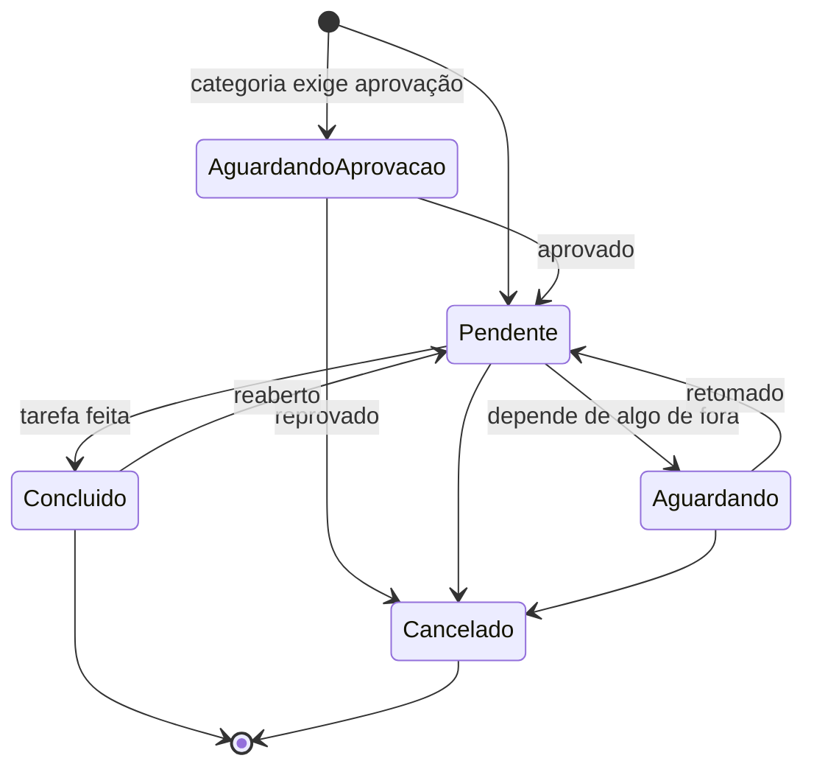

# 10. Como funcionam os chamados

Este documento descreve o ciclo de vida de um chamado. No TicketFlow, um chamado é uma **tarefa da equipe**: quem registra e quem executa são membros dos grupos ([modelo](08-organizacao-e-permissoes.md)). As permissões citadas estão em [Organização e permissões](08-organizacao-e-permissoes.md).

## 10.1 Anatomia de um chamado

| Campo | Descrição | Quem define |
|-------|-----------|-------------|
| Número | `#1234`, sequencial, nunca reutilizado | Sistema |
| Título e descrição | O que precisa ser feito (Markdown) | Quem registra |
| Tipo | Incidente, requisição ou tarefa (10.2) | Padrão da categoria; ajustável |
| Categoria | O que é a tarefa | Quem registra |
| Grupo | Fila responsável | Categoria (padrão) ou quem registra; muda por transferência |
| Responsável | Membro(s) que estão executando (**obrigatório**: não há chamado sem responsável) | Quem registra (ele mesmo, outros membros ou o grupo todo), quem assume ou quem atribui (uma ou várias pessoas do grupo, ou o grupo todo) |
| Registrado por | Membro que criou o chamado | Sistema |
| Setor atendido | Área para a qual a tarefa é feita (opcional) | Quem registra |
| Pessoa atendida | Nome de quem pediu ou será atendido, em texto livre, sem conta no sistema (opcional) | Quem registra |
| Status | Etapa do ciclo de vida (10.5) | Fluxo |
| Observadores | Colegas que acompanham | Qualquer membro do grupo |
| Tags | Marcadores livres | Membros do grupo |
| Vínculos | Duplicado de, relacionado a, bloqueado por | Membros do grupo |
| Anexos | Ver [Anexos e arquivos](11-anexos-e-arquivos.md) | Quem comenta |
| Resolução | Código + texto do que foi feito | Quem conclui |

## 10.2 Tipos de chamado

| Tipo | Quando usar | Exemplo |
|------|-------------|---------|
| **Incidente** | Algo que funcionava parou ou está com defeito | "ERP fora do ar no Financeiro" |
| **Requisição** | Alguém de fora da equipe pediu algo | "Criar acesso à pasta do Comercial para a Carla" |
| **Tarefa** | Trabalho planejado ou de rotina da própria equipe | "Trocar o switch do 2º andar", "Renovar o certificado do site" |

O tipo vem da categoria e pode ser corrigido. Ele é usado nos relatórios. Os nomes são uma proposta e a equipe pode ajustá-los ([questões em aberto](questoes-em-aberto.md)).

## 10.3 Prioridade (removida)

Os chamados **não têm prioridade**, nem impacto e urgência (decisão de 2026-10-13). As filas seguem a ordem de registro, do mais antigo para o mais novo (10.6). A numeração das seções foi mantida.

## 10.4 Registro

### Como um chamado nasce

| Origem | Como funciona | Fase |
|--------|---------------|------|
| **Formulário** | Um membro registra pelo botão "Novo chamado", sempre visível, num dos seus grupos; o admin, em qualquer grupo ativo (o responsável é sempre membro do grupo) | 1 |
| **API / integrações** | `POST /tickets` com token de API | Futuro |
| **Agente de IA / MCP** | Via API ou servidor MCP | Futuro |

Pedidos que chegam por fora (telefone, conversa, mensagem) são registrados por quem os recebeu, preenchendo o **cliente** (do cadastro de clientes, opcional) e o **contato**, quem pediu.

### Formulário

```
Grupo*         [TI – Suporte ▾]            (só os grupos de que sou membro)
Categoria*     [TI › Acessos › Novo acesso ▾]   (filtrada pelo grupo; busca por texto)
Título*        [______________________________________]
Descrição      [ editor de texto (colar prints)       ]
Para quem      Setor [Comercial ▾]   Pessoa [Carla Dias      ]   (opcionais)
Usuários       [Ana ×] [+ adicionar pessoa ▾]   (começa com quem registra; pelo menos uma pessoa;
                                                 "Todas as pessoas do grupo" marca todos os membros)
Observadores   [+ adicionar colega]
📎 Arraste arquivos aqui ou clique para anexar
                                                   [Cancelar] [Registrar]
```

Ao registrar:

1. O sistema grava quem registrou.
2. Se a categoria **exige aprovação**, o chamado nasce em "Aguardando aprovação" e os supervisores do grupo são avisados (10.8).
3. Senão, nasce em **Pendente**, com o responsável escolhido e o cliente (os dois obrigatórios).
4. O grupo é avisado conforme a configuração dele: só a fila, ou e-mail para todos os membros.

## 10.5 Status e fluxo

> As etapas abaixo são o **padrão proposto** e ainda serão discutidas pela equipe. O administrador pode criar outras.

### Status padrão

| Status | `kind` | Significado |
|--------|--------|-------------|
| **Pendente** | `open` | Em aberto, com o responsável |
| **Aguardando** | `waiting` | Parado por algo de fora: outra pessoa, peça, fornecedor, janela de manutenção |
| **Concluído** | `closed` | Final. A tarefa foi feita |
| **Cancelado** | `canceled` | Final. Não era necessário, era duplicado ou foi reprovado |

**Status criados pelo administrador:** cada um tem um nome e um `kind`: `open`, `waiting`, `closed`, `canceled` ou `approval` (usado nas aprovações, 10.8). As regras do sistema dependem do `kind`, não do nome. Exemplos: "Em andamento" (`open`), "Aguardando aprovação" (`approval`). Entre status do mesmo `kind`, muda-se livremente.

**Nada muda de status sozinho com o passar do tempo.** Concluir é sempre uma ação de uma pessoa.

### Diagrama



### Transições: quem pode e o que é exigido

| De | Para | Quem | Exigências / efeitos |
|----|------|------|----------------------|
| Aprovação (`approval`) | Pendente | Supervisor do grupo | Comentário opcional |
| Aprovação (`approval`) | Cancelado | Supervisor do grupo | **Motivo obrigatório** |
| Pendente | Aguardando | Responsável ou supervisor | **Comentário obrigatório**: o que se está esperando |
| Aguardando | Pendente | Membro do grupo | Manual |
| Pendente | Concluído | Responsável ou supervisor | **Texto do que foi feito + código de resolução** obrigatórios |
| Concluído | Pendente | Membro do grupo | **Motivo obrigatório**. Contador de reaberturas +1. Volta para o mesmo responsável |
| Qualquer não final | Cancelado | Quem registrou, responsável ou supervisor | **Motivo obrigatório** (duplicado → usar mesclagem) |
| Cancelado | — | — | Final. O botão "Novo chamado relacionado" cria um chamado vinculado |

### Códigos de resolução

Feito · Feito com solução de contorno · Não reproduzível · Fora do escopo do grupo. A lista é configurável e serve para os relatórios.

## 10.6 Como a equipe trabalha

### Visões (filas) padrão

| Visão | Conteúdo | Para quem |
|-------|----------|-----------|
| **Meus chamados** | Chamados em que sou o responsável, ainda abertos | Todos |
| **Aguardando** | Chamados dos meus grupos parados em `waiting` | Todos |
| **Acompanhando** | Chamados em que sou observador | Todos |
| **Todos** | Tudo o que vejo, com filtro por grupo, responsável e status | Todos |
| **Aprovações** | Chamados aguardando a minha aprovação | Supervisores (Fase 2) |

**Ordenação padrão:** a data de registro (mais antigo primeiro).

**Indicadores na lista:** ícone de "novidade", responsável, setor atendido, há quanto tempo está parado.

### Distribuição do trabalho

- **Para si:** quem registra já pode ficar como responsável, o caso mais comum quando a pessoa vai executar a tarefa.
- **Assumir:** o membro assume um chamado específico de um colega do grupo. Não há fila de não atribuídos nem "Pegar o próximo" (removidos em 2026-10-15: todo chamado tem responsável e cliente).
- **Empurrar:** qualquer membro atribui chamados a outros membros do grupo; no registro, a uma ou mais pessoas, ou ao grupo todo. A atribuição em massa é do supervisor.
- **Automática** (futuro): por rodízio ou menor carga.

### Tela do chamado

```
┌──────────────────────────────────────────────────────────────────────────────┐
│ #1234  Impressora do 3º andar não imprime     [Pendente ▾] [Alta]            │
│ Registrado há 2h10 por Bruno  ·  Ana também está vendo                       │
├───────────────────────────────────────────────┬──────────────────────────────┤
│ LINHA DO TEMPO                                │ Grupo: TI – Suporte          │
│ ● Bruno · 09:02                               │ Responsável: Ana             │
│   Financeiro avisou por telefone: "offline"   │ Categoria: TI › Impressão    │
│                                               │ Tipo: Incidente              │
│ ● Ana · 09:20                                 │ Para: Financeiro · João Silva│
│   Verificar o switch do andar                 │──────────────────────────────│
│ ● Ana · 09:25 · @Carlos                       │ Observadores: Bruno, Carlos  │
│   Carlos, consegue olhar a porta 12?          │ Tags · Vínculos              │
│                                               │ Anexos (2)                   │
├───────────────────────────────────────────────┤                              │
│ ┌───────────────────────────────────────────┐ │                              │
│ │ Descreva a tarefa feita…                  │ │                              │
│ └───────────────────────────────────────────┘ │                              │
│ Tempo gasto [01:30 ▾]               📎 Anexar │                              │
│ [Adicionar tarefa]                            │                              │
└───────────────────────────────────────────────┴──────────────────────────────┘
```

- **Linha do tempo:** mostra só o registro e os comentários (andamentos), cada um com a sua data. As alterações (assumir, devolver, acompanhar, transferir, mudar status…) continuam gravadas no histórico, mas não aparecem na tela.
- **Tarefas:** na tela, os comentários se chamam **tarefas** (o andamento do chamado); na API continuam `comments`. O botão é **Adicionar tarefa**.
- **Tarefa e mudança de status:** a tarefa e a mudança de status saem numa única ação. Concluir não aparece na tela: no fim da lateral, o botão amarelo-ouro **Marcar como entregue** (quem tem `set_status`) leva o chamado à revisão do supervisor ("Entregue"), num clique, sem confirmação, sem tarefa nem código de resolução. Ele usa o status padrão do comportamento Entregue (`delivered`), não o nome, e não aparece em chamado já entregue, concluído ou cancelado. "Aguardar" não aparece na tela (decisão de 2026-10-14); quem já está aguardando pode ser retomado.
- **Status na lateral:** quem tem `set_status` escolhe qualquer status num seletor na lateral, sem tarefa nem comentário.
- **Entregue (revisão do supervisor):** comportamento próprio (`delivered`), como Em aberto, Em espera, Encerrado e Cancelado, com o status "Entregue" como padrão (decisões de 2026-10-14). É para os chamados entregues que o supervisor vai verificar antes de concluir. Enquanto o chamado está num status entregue, só o **supervisor do grupo ou o admin** o leva a um status encerrado (Concluído): para os demais, o seletor não mostra esses status. Os entregues continuam em **Meus**, **Acompanhando** e na aba **Aguardando** (onde o supervisor os encontra); dali dá para retomar (volta a Pendente) ou cancelar.
- **Tempo gasto (andamentos):** cada comentário é um andamento do chamado e pode levar o **tempo gasto** nele (opcional), num campo **hh:mm**: digitado (os números entram pela direita: "130" vira 01:30) ou escolhido na lista de horários (00:20, 00:30, de 15 em 15 minutos até 03:00 e de hora em hora até 24:00). A cobrança dos funcionários é feita por esse tempo. A lateral mostra o **total** do chamado e a **soma de cada pessoa** (quem gastou mais primeiro); cada comentário mostra o seu tempo. Tempo sem comentário não é aceito (ex.: "Retomar" sem texto). O tempo se corrige na edição do comentário (10 minutos), e o valor anterior fica no histórico.
- **Menções:** `@nome` notifica o colega, que vira observador do chamado.
- **Colisão:** o sistema mostra quem mais está com o chamado aberto ("Ana também está vendo", ao lado de "Registrado há…", atualizado a cada 20 s). Se chegou um comentário novo depois que a tela foi carregada, o mesmo trecho avisa ("1 tarefa nova · Recarregar"), e o envio de uma tarefa com a tela desatualizada não grava: a página volta com a tarefa nova à vista e o texto preservado, e o envio seguinte passa. Alterações de campos (status, cliente, "Marcar como entregue" e o `PATCH` da API) usam `ETag` para não sobrescrever a mudança de outra pessoa; tarefas, responsáveis e observadores não contam.
- **Rascunho automático:** o texto em edição é salvo localmente no navegador e restaurado se a página for recarregada.
- **Histórico do setor:** acesso rápido aos últimos chamados do mesmo setor atendido.

### Transferência

| Situação | Como funciona |
|----------|---------------|
| **Transferência** (ex.: Suporte → Infraestrutura) | Escolhe-se o grupo de destino e escreve-se um **motivo obrigatório**, que vira comentário. Escolhe-se também o **novo responsável**, um membro do grupo de destino. O chamado continua **Pendente**, com esse responsável. O grupo anterior mantém acesso de leitura |
| **Pedir ajuda sem transferir** | Comentário com `@menção` a um colega de outro grupo, que vira observador |

### Duplicados e vínculos

- **Mesclar:** o chamado secundário é **cancelado** com o código "Duplicado" e vinculado ao principal (`duplicate_of`). Os observadores do secundário passam para o principal. Os conteúdos não são movidos: o vínculo permite consultar os dois.
- **Relacionado a / bloqueado por:** só informativos, exibidos nos dois chamados.

### Ações em massa (supervisor ou permissão `ticket.bulk`)

**Feito:** na lista de chamados, o supervisor (nos chamados dos grupos que supervisiona) e o admin marcam vários chamados (ou todos da página) e escolhem o **novo status** numa janela flutuante no pé da tela, que aparece enquanto há chamados marcados. Cada chamado passa pelas próprias regras (a da revisão inclusive); os que não podem mudar ficam selecionados e o motivo aparece num aviso. Cada linha da lista também mostra o **total de horas** das tarefas (ao lado da última movimentação) e, no fim, um botão com um lápis que abre o chamado.

Planejado: atribuir, transferir, adicionar tag, concluir com o mesmo texto (ex.: incidente geral resolvido) e adicionar comentário.

### Regras de edição

- O autor edita a tarefa **a qualquer momento**: o texto, o tempo gasto e a **data e hora em que foi feita** (`done_at`; começa como a hora do registro, nunca no futuro). A linha do tempo segue essa data. As versões anteriores ficam no histórico.
- O autor **remove** a tarefa (confirmação na própria tarefa, sem janela). Ela sai da tela, do tempo gasto, da busca e das novidades, com os anexos dela, mas não é apagada do banco (`deleted_at`): o texto e o tempo ficam no histórico (`comment.deleted`). Com `ticket.hide_content`, um anexo pode ser **ocultado**, com motivo, e o original continua na auditoria (ex.: alguém colou uma senha).

## 10.7 Observadores

- Qualquer membro do grupo adiciona colegas como observadores; qualquer usuário pode se adicionar a um chamado que já vê.
- Observadores de **outros grupos** veem o chamado e comentam, mas não alteram campos nem status.
- O observador recebe as atualizações (10.10) e encontra os chamados na visão **Acompanhando**.

## 10.8 Aprovações (Fase 2)

- Ativadas **por categoria** (`requires_approval`), para tarefas que precisam do "ok" antes de começar (ex.: compra de equipamento).
- **Quem aprova:** os **supervisores do grupo** do chamado. Se houver vários, qualquer um decide.
- Se quem registrou for supervisor do grupo, o chamado já nasce aprovado, e isso fica no histórico.
- Se o grupo não tiver supervisor, a aprovação vai para os administradores.
- O supervisor recebe um aviso com link e decide na tela: **Aprovar** (comentário opcional) ou **Reprovar** (motivo obrigatório).
- Para usar aprovações, o administrador cria um status com `kind = approval` (ex.: "Aguardando aprovação"). Ele não faz parte dos status padrão.
- Lembretes após 1 e 3 dias.
- Um nível de aprovação. Vários níveis ficam para o futuro.

## 10.9 Prazos: sem SLA

Não há SLA: não existem metas de prazo, alertas de vencimento nem calendário de expediente (decisão de 2026-10-09). O sistema só **mede** os tempos (até alguém assumir, até concluir) para os relatórios.

## 10.10 Notificações

| Evento | Responsável | Observadores | Grupo | Supervisores | Outros |
|--------|:-:|:-:|:-:|:-:|---|
| Atribuído a alguém | ✉️🔔 | | | | |
| Aguardando aprovação | | | | ✉️🔔 | |
| Aprovado / reprovado | 🔔 | 🔔 | | | Quem registrou 🔔 |
| Comentário novo | 🔔 | 🔔 | | | |
| @menção | | | | | Mencionado ✉️🔔 |
| Transferido | | | 🔔 novo grupo | | |
| Concluído | | ✉️🔔 | | | Quem registrou 🔔 |
| Reaberto | ✉️🔔 | 🔔 | | | |

✉️ e-mail · 🔔 notificação dentro do sistema (Fase 2). Na Fase 1, enquanto o sino não existe, os eventos marcados só com 🔔 também vão por e-mail. Quem causou o evento nunca é notificado dele. Cada usuário escolhe nas preferências como quer receber, exceto atribuição, menção e aprovação pendente, que não podem ser desligadas.

**Na Fase 1 (F1-S4-04, [ARCHITECTURE 3.13](../ARCHITECTURE.md#313-notificações-por-e-mail-modulesnotifications)):** tudo por e-mail, ainda sem preferências (elas entram com o sino, F2-S6-01). No registro, o grupo com "e-mail para todos os membros" (10.4) também é avisado. Cada pessoa recebe um e-mail só por ação (menção, depois atribuição, depois o resto). O comentário de uma ação vai no e-mail dela; o de aguardar, retomar ou cancelar não gera e-mail. Concluído e reaberto valem também para a mudança pelo formulário e em massa.

## 10.11 Rotinas automáticas (worker)

| Rotina | Frequência |
|--------|------------|
| Lembrar supervisores de aprovações pendentes | Diária |
| Limpar uploads não vinculados há mais de 24 h | Diária |

Nenhuma rotina muda o status de um chamado.
