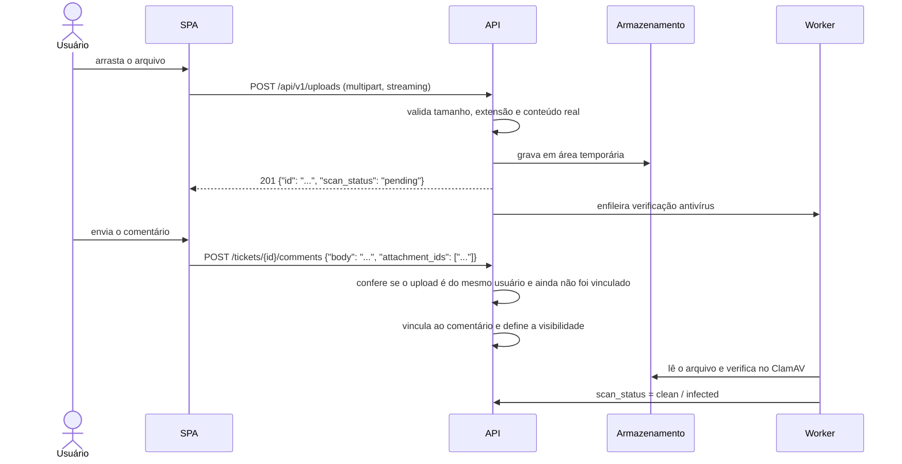

# 11. Anexos e arquivos

## 11.1 Onde os arquivos podem ser vinculados

| Onde | Vinculado a | Visibilidade | Fase |
|------|-------------|--------------|------|
| Abertura do chamado | Chamado | Pública | 1 |
| Comentário público | Comentário (e chamado) | Pública | 1 |
| Nota interna | Comentário (e chamado) | **Interna**: só quem vê notas internas | 1 |
| Imagem colada no editor (print de tela) | Comentário | A mesma do comentário | 1 |
| Solução (ao resolver) | Comentário da solução | Pública | 1 |
| Anexos de e-mail recebido | Chamado ou comentário criado a partir do e-mail | Pública | 2 |
| Artigo da base de conhecimento | Artigo | A mesma do artigo | 2 |
| Foto do usuário (avatar) | Usuário | Todos os usuários logados | 2 |
| Logotipo da empresa | Configurações | Pública (inclusive na tela de login) | 2 |
| Exportações (CSV de relatórios) | Usuário que pediu | Só quem pediu; expira em 24 h | 2 |
| Importação de usuários (CSV) | Processo de importação | Admin; apagado após o processamento | 1 |

**Regra geral:** um anexo herda a visibilidade do lugar onde foi vinculado. Um arquivo enviado numa nota interna **nunca** aparece para o solicitante, nem na lista de anexos do chamado.

Na lista de anexos, a lateral da tela do chamado reúne os arquivos de todos os comentários, indicando a origem e se é interno.

## 11.2 Tipos de arquivo

A validação usa a **extensão e o conteúdo real** do arquivo, identificado pelos primeiros bytes (*magic numbers*). Se os dois não baterem, o arquivo é recusado.

| Grupo | Extensões | Padrão |
|-------|-----------|--------|
| Imagens | png, jpg/jpeg, gif, webp, heic | Permitido |
| Documentos | pdf, docx, xlsx, pptx, odt, ods, odp, txt, csv, rtf, md | Permitido |
| E-mails | eml, msg | Permitido |
| Logs e dados | log, json, xml, yaml | Permitido |
| Compactados | zip, 7z | **Configurável** (padrão: permitido só com antivírus ativo) |
| Office com macro | docm, xlsm, pptm | **Bloqueado** (configurável) |
| Executáveis e scripts | exe, msi, bat, cmd, com, scr, ps1, vbs, js, jar, sh, dll, apk, app | **Sempre bloqueado** |
| Conteúdo web ativo | html, htm, svg, xhtml | **Sempre bloqueado** (risco de XSS) |

O administrador ajusta a lista de permitidos, mas não pode liberar os itens marcados como "sempre bloqueado".

## 11.3 Limites (padrões configuráveis)

| Limite | Padrão |
|--------|--------|
| Tamanho por arquivo | 25 MB |
| Arquivos por envio | 10 |
| Total por chamado | 200 MB |
| Imagem colada no editor | 10 MB |
| Avatar | 2 MB, redimensionado para 256×256 |

Se houver um proxy reverso na frente, o limite de corpo da requisição dele precisa ser compatível (ex.: `client_max_body_size` no nginx).

## 11.4 Fluxo de envio em duas etapas

O arquivo é enviado **antes** do formulário ser submetido. Isso permite barra de progresso, arrastar e soltar, colar imagens no editor e não perder o upload se a validação do formulário falhar.

- Um upload **só pode ser vinculado por quem o enviou** e **uma única vez**.
- Uploads não vinculados são apagados após 24 h.
- O nome original é saneado (sem caminhos nem caracteres de controle, até 255 caracteres) e guardado **só no banco**. No armazenamento, o arquivo tem um nome aleatório.

## 11.5 Antivírus

- **ClamAV** opcional, com o serviço `clamav-daemon` no mesmo servidor, acessado pelo worker.
- Estados do arquivo: `pending` → `clean` | `infected` | `error`. Com o antivírus desligado, o estado é `not_scanned`.
- Enquanto está `pending`, só quem enviou consegue baixar o arquivo. Os demais veem "Verificando…".
- Um arquivo `infected` é movido para quarentena, fica indisponível para download e gera um alerta para o administrador e um evento no chamado ("Anexo bloqueado pelo antivírus").

## 11.6 Armazenamento

Interface `Storage` (`put`, `get`, `delete`, `presigned_url`) com dois adaptadores:

| Adaptador | Quando usar |
|-----------|-------------|
| **Local** (usado na Martiniti) | Diretório `/var/lib/sistema-chamados/files`, só acessível pelo usuário do serviço |
| **S3-compatível** (futuro) | AWS S3, MinIO etc. Só faz sentido com vários servidores |

- **Chave do arquivo:** `attachments/AAAA/MM/<uuid>`, sem o nome original.
- **Integridade:** o SHA-256 é calculado durante o envio e conferido em leituras sensíveis. Não há deduplicação entre chamados, porque ela revelaria que dois usuários enviaram o mesmo arquivo.
- **Backup:** os arquivos precisam de backup **junto** com o banco. O guia de instalação deve deixar isso explícito.

## 11.7 Download e visualização

`GET /api/v1/attachments/{id}`:

1. Verifica se o usuário **vê o chamado** e se **vê a visibilidade** do anexo (interna ou pública).
2. Recusa se `scan_status` for `infected`, ou `pending` para quem não enviou.
3. Devolve o arquivo em *streaming*.
4. Headers: `Content-Disposition: attachment` (padrão) com o nome original; `X-Content-Type-Options: nosniff`; `Content-Security-Policy: sandbox`.
5. **Visualização no navegador** (`inline`) só para imagens (png, jpg, gif, webp) e PDF.
6. Downloads de anexos internos ou de chamados confidenciais são registrados na auditoria.

**Miniaturas** (Fase 2): o worker gera miniaturas das imagens com Pillow e as guarda como arquivos derivados, para a linha do tempo carregar rápido.

## 11.8 Permissões sobre anexos

| Ação | Quem |
|------|------|
| Enviar | Quem pode comentar no chamado (ou escrever nota interna, se o anexo for interno) |
| Baixar | Quem vê o chamado **e** a visibilidade do anexo |
| Ocultar | Quem tem `ticket.hide_content`, com motivo. O arquivo continua guardado para auditoria |
| Apagar fisicamente | Ninguém pela interface. Só pelos processos de retenção e de anonimização (LGPD) |

O solicitante **não** pode apagar um anexo depois de enviá-lo. Se enviou algo por engano, pede ao agente que o oculte.

## 11.9 Retenção, LGPD e IA

- Os anexos seguem a **política de retenção** do chamado. A anonimização de um titular apaga fisicamente os arquivos dos chamados dele.
- Os anexos **não são enviados à IA** por padrão.
- Na Fase 4 (opcional): extração de texto de PDF e DOCX para a busca e para a IA, respeitando `ai_allowed` da categoria e o mascaramento de dados pessoais.

## 11.10 Modelo de dados

A tabela `attachments` substitui a antiga `ticket_attachments`. Ver o [esboço do schema](esboco-schema.sql).

| Coluna | Descrição |
|--------|-----------|
| `ticket_id`, `comment_id`, `kb_article_id` | Dono do arquivo. Todos nulos = upload temporário ainda não vinculado |
| `visibility` | `public` ou `internal`, definida ao vincular |
| `filename`, `content_type`, `size_bytes`, `sha256` | Metadados |
| `storage_backend`, `storage_key` | Onde o arquivo está guardado |
| `scan_status`, `scanned_at` | Resultado do antivírus |
| `uploaded_by`, `created_at`, `linked_at` | Rastreabilidade |
| `hidden_at`, `hidden_by`, `hidden_reason` | Ocultação |
