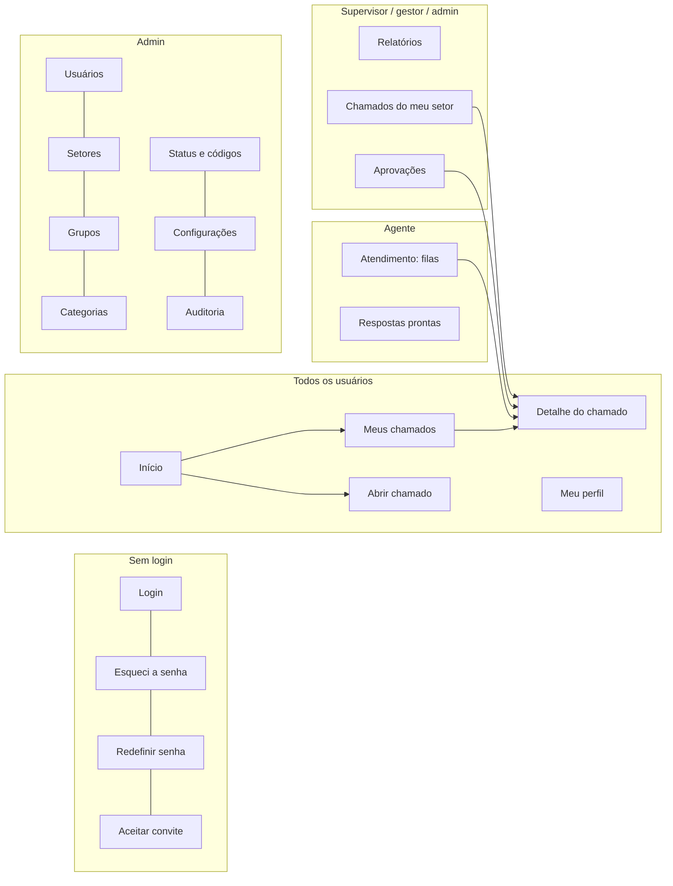

# 13. Telas e navegação

Mapa de todas as telas da interface (SPA em Vue, [ADR 0007](adr/0007-interface-web-vue.md)), quem acessa cada uma e os rascunhos das telas principais. O detalhe do chamado do ponto de vista do agente está em [10.6](10-chamados.md#106-como-o-agente-trabalha).

## 13.1 Estrutura geral

```
┌──────────────┬──────────────────────────────────────────────────────────────┐
│ ☰ Chamados   │ 🔍 Buscar chamado (número ou texto)    [+ Abrir chamado] 🔔 👤 │
├──────────────┼──────────────────────────────────────────────────────────────┤
│ Menu lateral │                                                              │
│ (conforme o  │                     Área de conteúdo                         │
│  perfil)     │                                                              │
│              │                                                              │
└──────────────┴──────────────────────────────────────────────────────────────┘
```

| Elemento | Comportamento |
|----------|---------------|
| **Busca global** | Digitar `1234` ou `#1234` abre o chamado direto; texto busca nos chamados que o usuário pode ver |
| **Abrir chamado** | Sempre visível, para todos os perfis |
| **Sino** 🔔 | Notificações no sistema (Fase 2) |
| **Menu do usuário** 👤 | Meu perfil, Sair |
| **Menu lateral** | Muda conforme o perfil (13.3). Em telas menores que 768 px vira uma gaveta aberta pelo ☰ |

## 13.2 Mapa de telas



## 13.3 Lista de telas

| Rota | Tela | Quem acessa | Fase |
|------|------|-------------|------|
| `/login` | Login | Todos | 1 |
| `/esqueci-senha` · `/redefinir-senha/:token` · `/convite/:token` | Recuperação de senha e primeiro acesso | Todos | 1 |
| `/` | **Início** | Todos (conteúdo muda por perfil, 13.4) | 1 |
| `/chamados` | **Meus chamados** (abertos por mim ou em que sou observador) | Todos | 1 |
| `/chamados/novo` | **Abrir chamado** (catálogo → formulário) | Todos | 1 |
| `/chamados/:numero` | **Detalhe do chamado**. Mesma rota para todos; o que aparece depende das permissões (`allowed_actions`) | Quem pode ver o chamado | 1 |
| `/atendimento` | **Filas do agente** (abas: Não atribuídos, Meus, Aguardando minha ação, Aguardando cliente, Entregues, Todos do grupo) | Agentes | 1 |
| `/setor` | **Chamados do meu setor** (somente leitura) | Gestores de setor | 1 |
| `/aprovacoes` | Aprovações pendentes e decididas | Aprovadores | 2 |
| `/respostas-prontas` | Minhas respostas prontas e as do grupo | Agentes | 1 |
| `/conhecimento` | Base de conhecimento | Todos (artigos internos só para agentes) | 2 |
| `/relatorios` | Painéis e relatórios ([14](14-relatorios-e-indicadores.md)) | Supervisores, gestores, admin, auditor | 2 |
| `/perfil` | Dados pessoais, senha, sessões ativas, notificações, MFA | Todos | 1 (MFA e notificações: 2) |
| `/admin/usuarios` | Usuários: criar, convidar, importar CSV, desativar, papel, setor | Admin | 1 |
| `/admin/setores` | Árvore de setores e gestores | Admin | 1 |
| `/admin/grupos` | Grupos de atendimento, membros e supervisores | Admin | 1 |
| `/admin/categorias` | Árvore de categorias, grupo padrão, tipo, aprovação, confidencialidade | Admin | 1 (aprovação: 2) |
| `/admin/status` | Status (criar com `kind`, renomear, ordenar) e códigos de resolução | Admin | 1 |
| `/admin/configuracoes` | Geral (nome, logotipo), e-mail de envio (SMTP), anexos (tipos, limites), matriz de prioridade | Admin | 1 |
| `/admin/email-entrada` | Caixas de e-mail monitoradas por grupo (IMAP) | Admin | 2 |
| `/admin/auditoria` | Log de auditoria com filtros | Admin, auditor | 1 |

Páginas de erro: **403** ("Você não tem acesso a este chamado"), **404** e **sessão expirada** (volta ao login e depois à página onde estava).

## 13.4 Menu lateral por perfil

| Item | Solicitante | Agente | Gestor de setor | Admin | Auditor |
|------|:-:|:-:|:-:|:-:|:-:|
| Início | ✅ | ✅ | ✅ | ✅ | ✅ |
| Meus chamados | ✅ | ✅ | ✅ | ✅ | — |
| Atendimento | — | ✅ | — | ✅ | — |
| Chamados do meu setor | — | — | ✅ | — | — |
| Aprovações (Fase 2) | se for aprovador | se for aprovador | ✅ | ✅ | — |
| Respostas prontas | — | ✅ | — | ✅ | — |
| Base de conhecimento (Fase 2) | ✅ | ✅ | ✅ | ✅ | ✅ |
| Relatórios (Fase 2) | — | supervisor | ✅ | ✅ | ✅ |
| Administração | — | — | — | ✅ | só Auditoria |

### Início por perfil

| Perfil | O que aparece |
|--------|---------------|
| Solicitante | Botão grande "Abrir chamado", meus chamados em andamento, chamados que precisam de resposta minha (Aguardando cliente, Entregue) |
| Agente | Contadores das filas (não atribuídos, meus, aguardando minha ação), botão "Pegar o próximo", meus chamados entregues ainda não concluídos |
| Gestor de setor | Chamados em andamento do setor, aprovações pendentes (Fase 2) |
| Admin | Resumo geral (abertos por grupo) e atalhos da administração |

## 13.5 Rascunhos das telas principais

### Abrir chamado

```
Passo 1 de 2 · O que você precisa?
┌──────────────────────────────────────────────────────────┐
│ 🔍 Descreva em poucas palavras…                          │
└──────────────────────────────────────────────────────────┘
┌───────────────┐ ┌───────────────┐ ┌───────────────┐
│ 💻 TI         │ │ 🧾 Financeiro │ │ 🏢 Facilities │
│ Acessos,      │ │ Reembolso,    │ │ Manutenção,   │
│ equipamentos  │ │ pagamentos    │ │ limpeza       │
└───────────────┘ └───────────────┘ └───────────────┘
  → ao escolher, mostra as subcategorias até chegar a uma categoria final

Passo 2 de 2 · TI › Acessos › Redefinir senha
  Título*          [______________________________________]
  Descrição*       [ editor de texto (colar prints)       ]
  Isso impede seu trabalho?   ( ) Posso esperar  ( ) Atrapalha  ( ) Estou parado
  Quem é afetado?             ( ) Só eu  ( ) Meu setor  ( ) A empresa toda
  📎 Arraste arquivos aqui ou clique para anexar
                                           [Voltar] [Abrir chamado]
```

Depois de enviar: tela de confirmação com o número (`#1234`) e o link para o chamado.

### Meus chamados (solicitante)

```
Meus chamados                       [Em andamento ▾] [🔍 Buscar]
┌──────┬──────────────────────────────┬────────────────────┬────────────┐
│ #    │ Título                       │ Situação           │ Atualizado │
├──────┼──────────────────────────────┼────────────────────┼────────────┤
│ 1234 │ Impressora do 3º andar       │ ● Precisamos de    │ há 10 min  │
│      │                              │   uma resposta sua │            │
│ 1229 │ Acesso à pasta Financeiro    │ ● Entregue: confira│ ontem      │
│ 1201 │ Notebook novo                │ ● Em andamento     │ 3 dias     │
└──────┴──────────────────────────────┴────────────────────┴────────────┘
```

A coluna "Situação" usa o texto amigável do status (`requester_label`). Chamados que pedem ação do solicitante aparecem primeiro.

### Filas do agente

```
Atendimento
[Não atribuídos 7] [Meus 12] [Aguardando minha ação 3] [Aguardando cliente 5] [Entregues 4] [Todos do grupo]
Grupo: [TI – Service Desk ▾]  Prioridade: [Todas ▾]  Categoria: [Todas ▾]      [Pegar o próximo]
┌───┬──────┬────────────────────────────┬──────────────┬──────────┬───────────┬──────────┐
│ ☐ │ #    │ Título                     │ Solicitante  │ Priorid. │ Responsáv.│ Aberto há│
├───┼──────┼────────────────────────────┼──────────────┼──────────┼───────────┼──────────┤
│ ☐ │ 1240 │ ERP fora do ar 💬          │ Ana (Financ.)│ ■ Crítica│ —         │ 15 min   │
│ ☐ │ 1238 │ Sem acesso à VPN           │ Rui (Comerc.)│ ■ Alta   │ —         │ 1 h      │
└───┴──────┴────────────────────────────┴──────────────┴──────────┴───────────┴──────────┘
Selecionados: [Atribuir ▾] [Transferir ▾] [Prioridade ▾]          (ações em massa: supervisor)
```

💬 = resposta nova do solicitante. Filtros e aba ativa ficam na URL (`/atendimento?aba=nao-atribuidos&grupo=3`), para que o link possa ser compartilhado.

### Telas de administração (padrão)

Todas seguem o mesmo padrão: lista com busca e filtro "ativos/inativos", botão **Novo**, e edição em um painel lateral. Não há exclusão, só **desativar** ([8.1](08-organizacao-e-permissoes.md#81-conceitos)).

## 13.6 Padrões de interação

| Situação | Padrão |
|----------|--------|
| Listas | Paginação "Carregar mais" (cursor da API); filtros e ordenação na URL |
| Ações destrutivas ou com motivo (cancelar, ocultar, transferir) | Modal de confirmação com o campo de motivo |
| Sucesso / erro | Aviso temporário (toast) no canto da tela; erros de formulário ao lado do campo |
| Carregando | Esqueleto (*skeleton*) do conteúdo, nunca tela em branco |
| Lista vazia | Mensagem explicando o que fazer (ex.: "Nenhum chamado aqui. Que tal pegar o próximo da fila?") |
| Datas | Relativas na lista ("há 10 min"); absolutas no detalhe, com fuso de São Paulo |
| Botões de ação | Só aparecem se a ação estiver em `allowed_actions` |
| Celular | Menu vira gaveta; no detalhe do chamado o painel lateral vai para baixo da linha do tempo |

## 13.7 Componentes do design system

Construídos sobre o Reka UI + Tailwind ([ADR 0008](adr/0008-reka-ui.md)), em `frontend/src/components/ui/`:

Botão · Campo de texto · Área de texto · Select · Combobox com busca (usuários, categorias) · Checkbox · Radio · Modal · Gaveta · Abas · Menu suspenso · Toast · Tooltip · Badge (status, prioridade) · Avatar · Tabela (com TanStack Table) · Paginação "carregar mais" · Árvore (setores, categorias) · Área de upload · Editor de texto (Tiptap, a confirmar) · Linha do tempo · Estado vazio · Esqueleto
