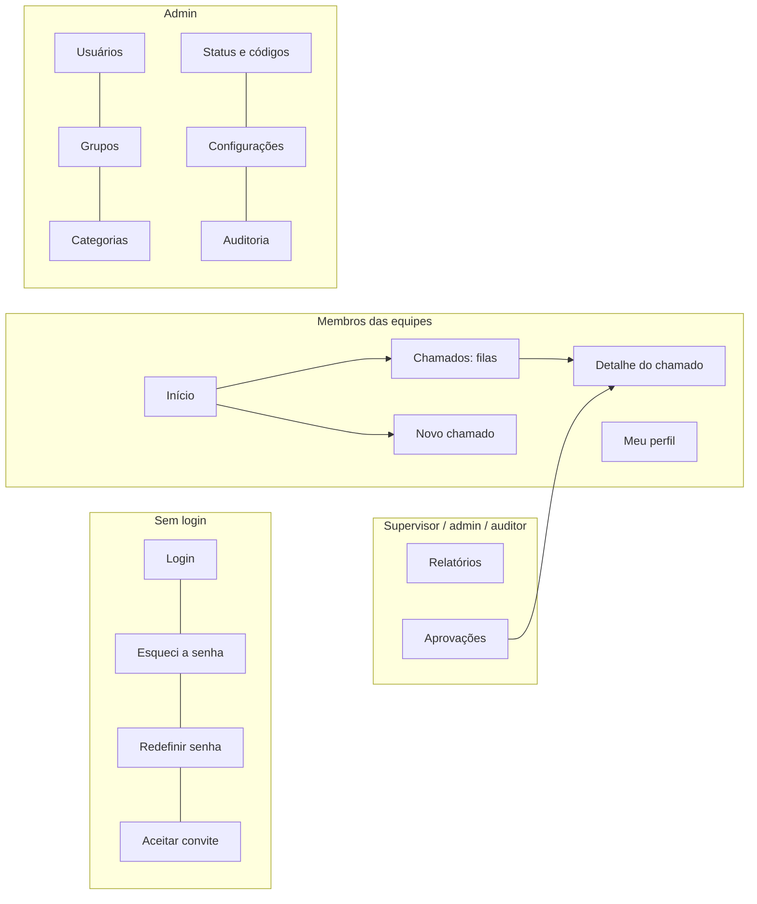

# 13. Telas e navegação

Mapa de todas as telas da interface (renderizadas no servidor, [ADR 0011](adr/0011-interface-web-no-servidor.md)), quem acessa cada uma e os rascunhos das telas principais. O detalhe do chamado e o formulário de registro estão em [10.4](10-chamados.md#104-registro) e [10.6](10-chamados.md#106-como-a-equipe-trabalha). Cores, tipografia e logotipo estão em [Identidade visual](17-identidade-visual.md).

Todos os usuários são membros das equipes ([modelo](08-organizacao-e-permissoes.md)); não existe área para colaboradores de fora.

## 13.1 Estrutura geral

```
┌──────────────┬──────────────────────────────────────────────────────────────┐
│ ▣ TicketFlow │ 🔍 Buscar chamado (número ou texto)     [+ Novo chamado] 🔔 👤 │
├──────────────┼──────────────────────────────────────────────────────────────┤
│ Menu lateral │                                                              │
│ (conforme o  │                     Área de conteúdo                         │
│  perfil)     │                                                              │
│              │                                                              │
└──────────────┴──────────────────────────────────────────────────────────────┘
```

| Elemento | Comportamento |
|----------|---------------|
| **Busca global** | Digitar `1234` ou `#1234` abre o chamado direto; texto busca nos chamados que o usuário pode ver |
| **Novo chamado** | Sempre visível para agentes e admin |
| **Sino** 🔔 | Notificações no sistema (Fase 2) |
| **Menu do usuário** 👤 | Meu perfil, Idioma (padrão do sistema, português, inglês), Sair. O tema (claro, escuro, automático) fica no botão ao lado |
| **Menu lateral** | Muda conforme o perfil (13.4). Em telas menores que 768 px vira uma gaveta aberta pelo ☰ |

## 13.2 Mapa de telas



## 13.3 Lista de telas

| Rota | Tela | Quem acessa | Fase |
|------|------|-------------|------|
| `/login` | Login | Todos | 1 |
| `/esqueci-senha` · `/redefinir-senha/:token` · `/convite/:token` | Recuperação de senha e primeiro acesso | Todos | 1 |
| `/` | **Início** | Todos (conteúdo muda por perfil, 13.4) | 1 |
| `/chamados` | **Filas** (abas: Meus, Aguardando, Acompanhando, Todos) | Agentes, admin, auditor (só leitura) | 1 |
| `/chamados/novo` | **Novo chamado** ([10.4](10-chamados.md#formulário)) | Agentes, admin | 1 |
| `/chamados/:numero` | **Detalhe do chamado**. O que aparece depende das permissões (`allowed_actions`) | Quem pode ver o chamado | 1 |
| `/aprovacoes` | Aprovações pendentes e decididas | Supervisores, admin | 2 |
| `/conhecimento` | Base de conhecimento da equipe | Todos | 2 |
| `/relatorios` | Painéis e relatórios ([14](14-relatorios-e-indicadores.md)) | Todos (cada um vê o seu painel; supervisores, admin e auditor veem os demais) | 2 |
| `/perfil` | Dados pessoais, senha, sessões ativas, notificações, tema, MFA | Todos | 1 (MFA e notificações: 2) |
| `/admin/usuarios` | Usuários: criar (senha inicial, grupos como membro), excluir, papel | Admin | 1 |
| `/admin/grupos` | Grupos, membros e supervisores | Admin | 1 |
| `/admin/categorias` | Árvore de categorias, grupo padrão, tipo, aprovação, confidencialidade | Admin | 1 (aprovação: 2) |
| `/admin/status` | Status (criar com `kind`, renomear, ordenar) e códigos de resolução | Admin | 1 |
| `/admin/empresa` | Dados da empresa que usa o sistema (razão social, CNPJ, inscrições, contato e endereço; o nome fantasia, a razão social, o CNPJ e o e-mail vão para o cabeçalho dos PDFs de relatório), o logotipo (menu e login) e o logotipo dos relatórios (PDFs). Desde 2026-10-28; os logotipos ficavam em Configurações | Admin | 1 |
| `/admin/configuracoes` | Idioma padrão (português ou inglês; cada pessoa pode escolher outro no menu do usuário) e as três cores da identidade com prévia nos modos claro e escuro ([17.2](17-identidade-visual.md#172-cores)); os filtros da tela de Relatórios que aparecem (período, grupo, pessoa, status e comparar com, todos ligados por padrão; [14.8.2](14-relatorios-e-indicadores.md#1482-filtros)). Depois: nome do sistema, e-mail de envio (SMTP), anexos (tipos, limites) | Admin | 1 |
| `/admin/auditoria` | Log de auditoria com filtros | Admin, auditor | 1 |

Páginas de erro: **403** ("Você não tem acesso a este chamado"), **404** e **sessão expirada** (volta ao login e depois à página onde estava).

## 13.4 Menu lateral por perfil

| Item | Agente | Supervisor | Admin | Auditor |
|------|:-:|:-:|:-:|:-:|
| Início | ✅ | ✅ | ✅ | ✅ |
| Chamados | ✅ | ✅ | ✅ | ✅ |
| Aprovações (Fase 2) | — | ✅ | ✅ | — |
| Base de conhecimento (Fase 2) | ✅ | ✅ | ✅ | ✅ |
| Relatórios (Fase 2) | ✅ (o próprio painel) | ✅ | ✅ | ✅ |
| Administração | — | — | ✅ | só Auditoria |

### Início por perfil

| Perfil | O que aparece |
|--------|---------------|
| Agente | Contadores (meus, aguardando), meus chamados mais antigos |
| Supervisor | O mesmo do agente + aprovações pendentes (Fase 2) e chamados do grupo parados há mais de 7 dias |
| Admin | Resumo geral (abertos por grupo) e atalhos da administração |
| Auditor | Resumo geral, só leitura |

## 13.5 Rascunhos das telas principais

### Filas

```
Chamados
[Meus 12] [Aguardando 5] [Acompanhando 2] [Todos]
Grupo: [TI – Suporte ▾]  Categoria: [Todas ▾]
┌───┬──────┬────────────────────────────┬──────────────┬───────────┬──────────┐
│ ☐ │ #    │ Título                     │ Para         │ Responsáv.│ Parado há│
├───┼──────┼────────────────────────────┼──────────────┼───────────┼──────────┤
│ ☐ │ 1231 │ Renovar certificado do site│ —            │ Ana       │ 2 dias   │
│ ☐ │ 1238 │ VPN do Rui não conecta     │ Comercial    │ —         │ 1 h      │
│ ☐ │ 1240 │ ERP fora do ar 💬          │ Financeiro   │ —         │ 15 min   │
└───┴──────┴────────────────────────────┴──────────────┴───────────┴──────────┘
Selecionados: [Atribuir ▾] [Transferir ▾]          (ações em massa: supervisor)
```

💬 = novidade (comentário de outra pessoa desde a última visita). Filtros e aba ativa ficam na URL (`/chamados?aba=nao-atribuidos&grupo=3`), para que o link possa ser compartilhado.

### Telas de administração (padrão)

Todas seguem o mesmo padrão: lista com busca e filtro "ativos/inativos", botão **Novo**, e edição em um painel lateral. Não há exclusão, só **desativar** ([8.1](08-organizacao-e-permissoes.md#81-conceitos)).

## 13.6 Padrões de interação

| Situação | Padrão |
|----------|--------|
| Listas | Paginação "Carregar mais" (cursor da API); filtros e ordenação na URL |
| Ações destrutivas ou com motivo (cancelar, ocultar, transferir, reprovar) | Modal de confirmação com o campo de motivo |
| Sucesso / erro | Aviso temporário (toast) no canto da tela; erros de formulário ao lado do campo |
| Carregando | Esqueleto (*skeleton*) do conteúdo, nunca tela em branco |
| Lista vazia | Mensagem explicando o que fazer (ex.: "Nenhum chamado aqui. Que tal pegar o próximo da fila?") |
| Datas | Relativas na lista ("há 10 min"); absolutas no detalhe, no fuso da máquina (servidor) |
| Botões de ação | Só aparecem se a ação estiver em `allowed_actions` |
| Celular | Menu vira gaveta; no detalhe do chamado o painel lateral vai para baixo da linha do tempo |

## 13.7 Componentes do design system

Macros Jinja com Tailwind e HTML nativo (`<dialog>`, `<details>`, `<select>`), em `backend/src/chamados/web/templates/_ui.html` e `_fields.html`, com as cores e a tipografia de [Identidade visual](17-identidade-visual.md):

Botão · Campo de texto · Área de texto · Select · Combobox com busca (usuários, categorias) · Checkbox · Radio · Modal · Gaveta · Abas · Menu suspenso · Toast · Tooltip · Badge (status) · Avatar · Tabela · Paginação "carregar mais" · Árvore (categorias) · Área de upload · Editor de texto (Tiptap, a confirmar) · Linha do tempo · Estado vazio · Esqueleto
